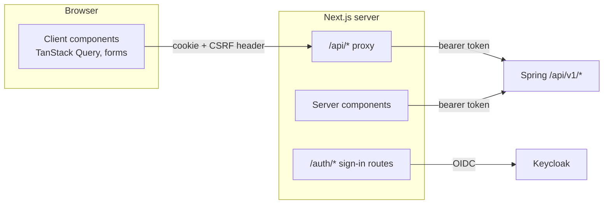

# Frontend Architecture

- **Type:** spec
- **Module:** platform
- **Status:** draft
- **Owner:** ishanKulkarni13
- **Last updated:** 2026-11-08

> **Implementation:** planned. There is no `frontend/` directory.

Decisions: [ADR 0021](../decisions/0021-frontend-beside-backend-in-one-repository.md), [ADR 0026](../decisions/0026-nextjs-bff-session.md), [ADR 0038](../decisions/0038-frontend-stack.md), [ADR 0042](../decisions/0042-bff-api-proxy-and-csrf.md), [ADR 0043](../decisions/0043-http-api-conventions.md).

## Purpose

How the Next.js application is organised and how it talks to the Spring backend. Sign-in itself is described in [authentication](identity/authentication.md).

## Two roles of the Next.js server

1. **Backend-for-frontend.** It signs users in, keeps their tokens in the encrypted session cookie and forwards API calls to Spring ([glossary](../shared/glossary/backend-for-frontend.md)).
2. **User interface.** It renders pages with the App Router, React server components and client components.

## Request paths

| Code | Calls Spring through | Notes |
|---|---|---|
| Server components and route handlers | The generated client, directly, with the token from the session | First page loads |
| Client components | The same generated client pointed at the `/api/*` proxy | Refreshing data, forms, uploads |
| Server Actions | Not used for API calls | All API logic stays in Spring |

The proxy attaches the token, checks CSRF (matching `Origin` plus the custom request header), streams bodies, passes trace context and strips cookies and hop-by-hop headers. It is security-critical and has its own tests.

## Conventions

- **Folders:** one feature folder per backend module, mirroring [package structure](../engineering/conventions/package-structure.md) (`identity`, `access`, `audit`, `files`, `notes`).
- **API client:** generated from the committed `openapi.json`; never hand-written request types.
- **Data:** server components for first loads; TanStack Query for client data that changes.
- **Forms:** React Hook Form with Zod for usability; the server's validation is authoritative. Validation errors come back as Problem Details `errors` and are mapped onto form fields.
- **Errors:** the frontend shows messages chosen from the error `code` ([API conventions](api/conventions.md)), and offers the `traceId` for support.
- **Permission-aware UI:** controls are hidden or disabled from the caller's permissions returned by `/me`. This is for usability only; Spring enforces every check.
- **Text:** English only, written directly in components. There is no translation library ([decision log](../temp/kibootia-decision-log.md), D-69).
- **Components:** Tailwind CSS with shadcn/ui components copied into the repository; accessibility target WCAG 2.2 AA.
- **Health:** a minimal `/healthz` route for the container check ([ADR 0047](../decisions/0047-health-exposure-and-container-images.md)).

## Testing

Vitest with Testing Library for non-trivial logic and the BFF module; Playwright for user-facing flows, including denied cases and an automated accessibility check ([verification standard](../engineering/testing/verification-standard.md)). None exist.

## Related

[Authentication](identity/authentication.md), [API conventions](api/conventions.md), [overview](overview.md).
