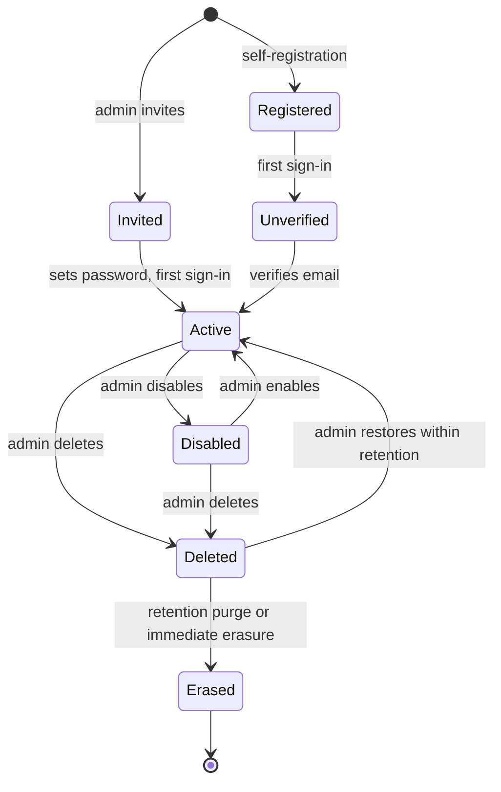

# User Lifecycle

- **Type:** spec
- **Module:** platform
- **Status:** draft
- **Owner:** ishanKulkarni13
- **Last updated:** 2026-11-08

> **Implementation:** planned. No Keycloak service, profile table or user-administration code exists.

Decisions: [ADR 0025](../../decisions/0025-identity-and-authorization-data-split.md), [ADR 0034](../../decisions/0034-soft-delete-with-retention-purge.md), [ADR 0041](../../decisions/0041-user-lifecycle-and-account-model.md), [ADR 0044](../../decisions/0044-authorization-enforcement-conventions.md), [ADR 0046](../../decisions/0046-audit-log-design.md).

## Purpose

The path of one user account from creation to erasure, and which system does what at each step.

## Who owns what

| Data or action | Owner |
|---|---|
| Credentials, login pages, sessions, tokens, identity emails | Keycloak |
| Username, email, first and last name | Keycloak (source of truth); Kibootia keeps a read copy |
| Avatar, preferences, status, roles, permissions | Kibootia's database (`identity` and `access` modules) |
| Audit entries | Kibootia's `audit` module, by user ID only |

## Lifecycle

| Step | What happens |
|---|---|
| Invite | An administrator enters an email address and may pre-assign roles. The backend creates the Keycloak user through the Admin API port and Keycloak emails a set-password link |
| Self-register | The user signs up on Keycloak's registration page (on by default in the reference application) |
| First sign-in | Kibootia creates `user_profile`, keyed by the Keycloak user ID, copies name and email from the token, and assigns the built-in `user` role |
| Unverified | Until the email address is verified, the decision point allows only viewing one's own profile, resending verification and signing out; other operations return `email_not_verified` |
| Every sign-in | The read copy of name and email is refreshed from the token |
| Profile changes | Avatar and preferences in Kibootia; password and email in Keycloak's account console, linked from the profile page |
| Disable | Kibootia marks the profile disabled, disables the Keycloak user and ends its sessions. The backend refuses the user's requests from the next request on |
| Delete | Soft delete in Kibootia, Keycloak user disabled; restorable by an administrator within the retention period |
| Erase | At the retention purge, or immediately on an administrator's privacy request: Kibootia rows and stored files are removed and the Keycloak account is deleted. Audit entries keep only the user ID and show "deleted user" |

Every administrative step is written to the [audit log](../audit-log.md).

## Safeguards

The built-in administrator role is protected and the last administrator cannot be removed, disabled or deleted ([ADR 0025](../../decisions/0025-identity-and-authorization-data-split.md)). In production the first administrator is granted by the one-time bootstrap setting.

## Known limitations

- Edits made directly in the Keycloak admin console reach Kibootia's read copy at the user's next sign-in.
- Production deployments that keep self-registration on must review bot protection and rate limits.

## Testing

Each transition needs an automated test, including the denied cases (unverified user, disabled user, last administrator). None exist.
