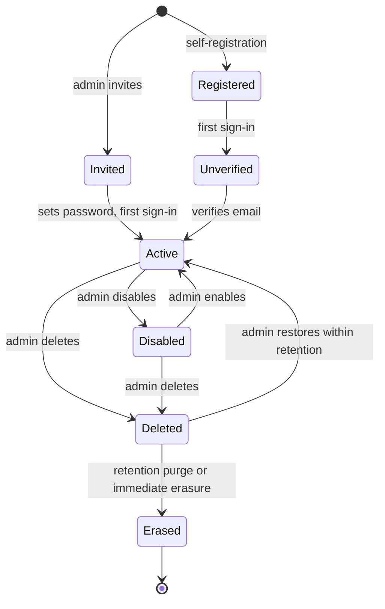

# User Lifecycle

- **Type:** spec
- **Module:** platform
- **Status:** draft
- **Owner:** ishanKulkarni13
- **Last updated:** 2026-11-10

> **Implementation:** verified (CI run 42780048416, 2026-11-10). Every transition below is built. `UserAdministrationIT`, `IdentityGateIT`, `AccessApiIT` and `KeycloakAdminAdapterIT` cover the backend, and three Playwright stories (`administration`, `registration`, `access-denied`) cover it against the real stack with Keycloak and Mailpit.

Decisions: [ADR 0025](../../decisions/0025-identity-and-authorization-data-split.md), [ADR 0034](../../decisions/0034-soft-delete-with-retention-purge.md), [ADR 0041](../../decisions/0041-user-lifecycle-and-account-model.md), [ADR 0044](../../decisions/0044-authorization-enforcement-conventions.md), [ADR 0046](../../decisions/0046-audit-log-design.md).

## Purpose

The path of one user account from creation to erasure, and which system does what at each step.

## Who owns what

| Data or action | Owner |
|---|---|
| Credentials, login pages, sessions, tokens, identity emails | Keycloak |
| Username, email, first and last name | Keycloak (source of truth); Kibootia keeps a read copy |
| Avatar, preferences, status, roles, permissions | Kibootia's database (`identity` and `access` modules) |
| Audit entries | Kibootia's `audit` module, by user ID only |

## Lifecycle

| Step | What happens |
|---|---|
| Invite | An administrator enters an email address and may pre-assign roles (which needs the permission to assign them). The backend creates the Keycloak user through the Admin API port, with a verified address (following the link proves the mailbox) and the required actions to set a password and a name, stores the profile, roles and audit entry in one transaction, and a durable event asks Keycloak to email the link. If Kibootia's part fails the Keycloak account is removed again |
| Self-register | The user signs up on Keycloak's registration page (on by default in the reference application) |
| First sign-in | The request gate confirms with Keycloak that the user exists, creates `user_profile`, keyed by the Keycloak user ID, copies name and email from the token, assigns the built-in `user` role and, for the bootstrap address, the administrator role. An invited user becomes active. An unverified user triggers the verification email through a durable event, because the realm's own setting is off |
| Unverified | Until the email address is verified, the decision point allows only viewing one's own profile, resending verification and signing out; other operations return `email_not_verified` |
| Every request | The read copy of name and email is refreshed from the token when the token is newer than the last copy and something differs |
| Profile changes | Avatar and preferences in Kibootia; password and email in Keycloak's account console, linked from the profile page |
| Disable | Kibootia marks the profile disabled and publishes an event; a durable handler disables the Keycloak user and ends its sessions, retrying through an outage. The backend refuses the user's requests from the next request on, whatever Keycloak has caught up with. Enabling reverses it |
| Delete | Soft delete in Kibootia, Keycloak user disabled by the same kind of event; restorable by an administrator within the retention period. Nobody can delete their own account, and the last administrator who can sign in cannot be deleted |
| Erase | Only for a deleted user, on an administrator's privacy request or when the retention job finds them expired. Erasure is marked and audited, then durable handlers delete the Keycloak account first, then the roles and the profile (and `notes` removes the user's notes). Until the account is gone the profile still refuses the user. Audit entries keep only the user ID and show "deleted user" |

Every administrative step is written to the [audit log](../audit-log.md).

## Safeguards

The built-in administrator role is protected and the last administrator who can sign in cannot be removed, disabled or deleted ([ADR 0025](../../decisions/0025-identity-and-authorization-data-split.md)); two administrators acting at the same moment cannot defeat it. The first administrator is the user who signs in with the address in `kibootia.identity.bootstrap-admin-email` and a verified email address while no administrator exists, or who verifies it afterwards; the grant is audited. Locally that is `demo-admin`. See [ADR 0050](../../decisions/0050-milestone-3-implementation-decisions.md).

## Known limitations

- Edits made directly in the Keycloak admin console reach Kibootia's read copy at the user's next sign-in.
- Production deployments that keep self-registration on must review bot protection and rate limits.

## Testing

Each transition has an automated test, including the denied cases (unverified user, disabled user, deleted user, the last administrator, a user acting on themselves). The Keycloak side is tested against a real Keycloak and a mail catcher; the rest uses a fake in place of Keycloak so that outages and repeats can be injected.
