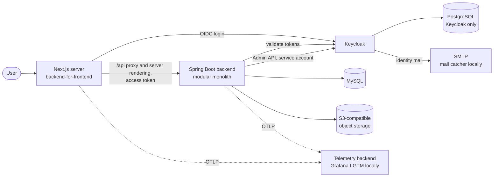

# Architecture Overview

- **Type:** spec
- **Module:** platform
- **Status:** draft
- **Owner:** ishanKulkarni13
- **Last updated:** 2026-11-08

> **Implementation:** planned. Observed today: a Spring Boot backend skeleton and a Compose MySQL ([implementation status](../product/roadmap/implementation-status.md)).

## Purpose

One page showing the intended building blocks and where the details live. It does not restate the details.

## Intended system context

Notes on the diagram:

- The browser talks only to the Next.js server, which holds the tokens and forwards browser API calls through one `/api` proxy ([ADR 0026](../decisions/0026-nextjs-bff-session.md), [ADR 0042](../decisions/0042-bff-api-proxy-and-csrf.md)). The backend has no CORS for browser traffic.
- Keycloak keeps its data in its own PostgreSQL and sends all identity email; the backend sends no mail ([ADR 0045](../decisions/0045-keycloak-operations.md), [ADR 0041](../decisions/0041-user-lifecycle-and-account-model.md)).
- Keycloak owns identity; Kibootia's database owns roles, permissions and profiles ([ADR 0025](../decisions/0025-identity-and-authorization-data-split.md)).
- Storage is reached through an S3 API contract ([ADR 0029](../decisions/0029-s3-object-storage-contract.md)); telemetry leaves the application only as OTLP ([ADR 0030](../decisions/0030-otlp-telemetry-and-local-lgtm.md)).
- Secrets reach the application as environment variables or files; Vault is a recommended source, not a component of the diagram ([ADR 0032](../decisions/0032-secrets-from-environment-and-files.md)).
- Nothing in this picture except the backend skeleton and MySQL exists in the repository.

## Building blocks

| Block | Role | Details |
|---|---|---|
| Backend | One deployable Spring Boot application, divided into the modules `platform`, `identity`, `access`, `audit`, `files` and `notes` | [layers and boundaries](layers-and-boundaries.md), [ADR 0002](../decisions/0002-modular-monolith.md), [ADR 0039](../decisions/0039-spring-modulith-module-boundaries-and-outbox.md) |
| Frontend | Next.js server that signs users in, forwards API calls and presents the application | [frontend](frontend.md), [ADR 0026](../decisions/0026-nextjs-bff-session.md), [ADR 0038](../decisions/0038-frontend-stack.md) |
| Keycloak | Identity provider using OpenID Connect, with its own PostgreSQL and its realm managed by OpenTofu | [identity](identity/README.md), [ADR 0045](../decisions/0045-keycloak-operations.md) |
| MySQL | Relational persistence, schema owned by Flyway migrations | [data](data/README.md) |
| Object storage | Avatars and uploads | [ADR 0029](../decisions/0029-s3-object-storage-contract.md) |
| Telemetry backend | Receives logs, metrics and traces | [observability baseline](../operations/monitoring/observability-baseline.md) |

## Principles that shape the design

Backend authority, explicit boundaries, separate models, secure by default, no dependency without a purpose. Their statements live in [goals and non-goals](../product/goals-and-non-goals.md).

## Related

[Context and boundaries](context-and-boundaries.md), [communication](communication.md), [ADR index](../decisions/INDEX.md).
