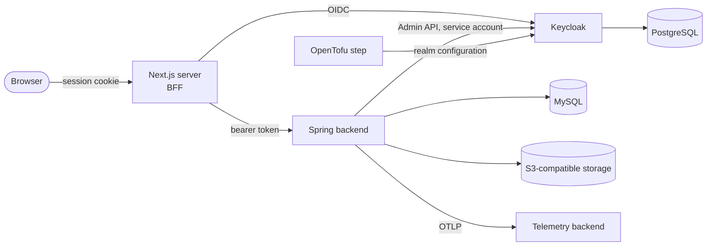

# Threat Model

- **Type:** spec
- **Module:** platform
- **Status:** draft
- **Owner:** ishanKulkarni13
- **Last updated:** 2026-11-10

> **Implementation:** the entries for milestones 1 and 2 are verified or observed as their rows in [implementation status](../../product/roadmap/implementation-status.md) say; the entries added for milestone 3 (marked below) are verified (CI run 42780048416, 2026-11-10). Entries for later milestones are intended mitigations only.

A living, short threat model organised by trust boundary (owner decision of 2026-10-28). Each capability adds its entries when it is built, and a milestone that adds a boundary is not complete until its entries exist. It lists what could go wrong and the intended mitigation, with the decision that fixes it. It is a starting point, not a completed analysis.

## Boundaries

## Entries

| Boundary | Threat | Intended mitigation | Decision |
|---|---|---|---|
| Browser to BFF | Script injection steals credentials | Tokens never reach the browser; HttpOnly, Secure, SameSite cookie; nonce-based content security policy | [0026](../../decisions/0026-nextjs-bff-session.md) |
| Browser to BFF | Cross-site request forgery on cookie-authenticated changes | Matching `Origin` header plus a required custom header on every state-changing request, with a SameSite cookie | [0042](../../decisions/0042-bff-api-proxy-and-csrf.md) |
| Browser to BFF | The `/api` proxy is abused to reach other hosts or leak cookies | Fixed upstream (Spring `/api` only); cookies and hop-by-hop headers stripped; dedicated proxy tests | [0042](../../decisions/0042-bff-api-proxy-and-csrf.md) |
| Browser to BFF | Session cookie tampering or theft | Encrypted cookie; short access-token lifetime; documented upgrade to a server-side store for revocation | [0026](../../decisions/0026-nextjs-bff-session.md) |
| BFF to Spring | Token meant for another client is accepted | Signature, issuer, expiry and audience checks | [0007](../../decisions/0007-spring-security-resource-server.md), [0008](../../decisions/0008-audience-validation-and-deny-by-default.md) |
| BFF to Spring | A new endpoint is exposed unprotected | Deny-by-default; no public endpoint on the API port; health on an internal management port | [0008](../../decisions/0008-audience-validation-and-deny-by-default.md), [0047](../../decisions/0047-health-exposure-and-container-images.md) |
| BFF to Spring | A machine token is used to act without a user | Service-account tokens are rejected | [0044](../../decisions/0044-authorization-enforcement-conventions.md) |
| Spring to Keycloak keys | Signing keys cannot be fetched | Use cached keys; with none, refuse requests | [token validation](../../architecture/identity/token-validation.md) |
| Spring to Keycloak Admin API | The service account is abused or leaked | Least-privilege realm-management roles, never realm-admin (a test shows a client with fewer roles is refused); secret from environment or file and never in an error message; administrative actions audited; its tokens are rejected by the API | [0025](../../decisions/0025-identity-and-authorization-data-split.md), [0050](../../decisions/0050-milestone-3-implementation-decisions.md) |
| Authorization | Privilege escalation through role editing | Protected admin role; last administrator cannot be removed; every change audited | [0025](../../decisions/0025-identity-and-authorization-data-split.md) |
| Authorization | A check is missing on one operation | One decision point; checks on use cases; an ArchUnit rule requires a check or an explicit exemption; allowed and denied tests for every protected operation | [0027](../../decisions/0027-central-authorization-decision-point.md), [0044](../../decisions/0044-authorization-enforcement-conventions.md) |
| Authorization | A disabled user keeps working with a still-valid session | Sessions ended in Keycloak; the backend checks profile status on every request | [0041](../../decisions/0041-user-lifecycle-and-account-model.md) |
| Authorization | Someone registers with the bootstrap administrator's address and is made administrator (milestone 3) | The grant needs a verified address in the token, only while no administrator exists; it is audited | [0050](../../decisions/0050-milestone-3-implementation-decisions.md) |
| Authorization | An administrator, or a role editor, grants more than they hold (milestone 3) | A role can only be given permissions its editor holds; only an administrator gives the administrator role; nobody changes their own account; the last administrator who can sign in cannot be removed, even concurrently | [0050](../../decisions/0050-milestone-3-implementation-decisions.md) |
| Authorization | An unverified account does anything beyond viewing itself (milestone 3) | The decision point returns no permissions until the token says the address is verified | [0041](../../decisions/0041-user-lifecycle-and-account-model.md) |
| Accounts | An old token of an erased user recreates their profile (milestone 3) | A user not yet known is confirmed with Keycloak first, and erasure deletes the Keycloak account before the profile | [0050](../../decisions/0050-milestone-3-implementation-decisions.md) |
| Accounts | Mass or fake self-registration, accounts in someone else's name | Email verification required before use; Keycloak brute-force detection; rate limits; production review of bot protection; new users see no other users by default | [0041](../../decisions/0041-user-lifecycle-and-account-model.md) |
| Data | One tenant reads another's data | `tenant_id` with a Hibernate discriminator; native queries reviewed; isolation tests in CI | [0028](../../decisions/0028-tenant-ready-schema.md) |
| Data | Soft-deleted personal data is retained or leaks through queries | Soft-delete filtering with tests; retention purge; immediate erasure on request | [0034](../../decisions/0034-soft-delete-with-retention-purge.md) |
| Data | Identifiers are guessed | UUIDv7 identifiers | [0033](../../decisions/0033-uuidv7-identifiers.md) |
| Uploads | Malicious or disguised file | Type detected from bytes, per-category allow-list, size limits, re-encoding and metadata removal for images; malware scanning is a recipe | [0029](../../decisions/0029-s3-object-storage-contract.md) |
| Storage | Files read without authorization | Storage on the private network; files streamed through the backend; access through the decision point | [0029](../../decisions/0029-s3-object-storage-contract.md) |
| Abuse | Brute-force login, invite spam, verification-mail floods, upload floods | Keycloak brute-force detection; in-app per-user rate limiter on invitations, verification mail and administrative actions (uploads in milestone 4); edge limiting required in production | [API conventions](../../architecture/api/conventions.md) |
| Secrets | Development credentials reach production | Generated local secrets; production refuses to start with development defaults | [0032](../../decisions/0032-secrets-from-environment-and-files.md) |
| Secrets | Committed credentials | Secret scanning in CI; credentials ever committed are rotated | [secrets management](secrets-management.md) |
| Operations | Sensitive data in logs or telemetry | Logs and traces exclude tokens and secrets | [observability baseline](../monitoring/observability-baseline.md) |
| Operations | Local observability stack exposed | The all-in-one container is for development only | [0030](../../decisions/0030-otlp-telemetry-and-local-lgtm.md) |
| Operations | Keycloak admin console attacked from the internet | Blocked at the proxy; reached only through an SSH tunnel | [0045](../../decisions/0045-keycloak-operations.md) |
| Operations | OpenTofu state leaks secrets | State stored privately and encrypted (S3 bucket) or as a root-only file; never committed | [0045](../../decisions/0045-keycloak-operations.md) |
| Data | Personal data retained in the audit log after erasure | Audit entries reference people by ID only | [0046](../../decisions/0046-audit-log-design.md) |

## Not yet covered

Supply-chain risks beyond dependency and image scanning, backup confidentiality, and the production telemetry backend. They are added with the milestone that introduces them ([milestone 6](../../product/roadmap/milestone-6-production-readiness.md)).
