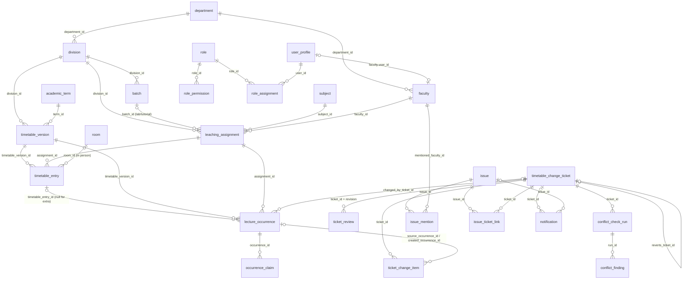

# The database of Timetia: viva preparation

- **Type:** guide (for the DBMS viva)
- **Module:** platform and all modules that own tables
- **Status:** draft, written 2026-11-16 from the working tree of branch `dog`
- **Source of truth:** the Flyway migrations in `backend/src/main/resources/db/migration/<module>/V*.sql`

Everything below was read from the real files. Line numbers (`File.java:123`) are those of the working tree on the day of writing and
will drift; the method and constant names will not. Where something could not be verified it says **(not verified)**. Where the
implementation has a limitation it says so plainly: say the same thing in the viva, it is better than being caught out.

How to read the paths: `JdbcTicketStore` means `backend/src/main/java/com/kibootia/backend/rescheduling/persistence/JdbcTicketStore.java`.
The package of each class is the module name (`timetable`, `rescheduling`, `reference`, `issues`, `notifications`, `access`, ...).

---

## 1. Overview

### 1.1 What the system keeps, and why

Timetia keeps the timetable of a college and lets teachers change single lectures through **tickets**, safely.

| Group | Data | Why it exists |
| --- | --- | --- |
| Campus | department, division, batch | The places a person can hold a role in (HOD of a department, CR of a division, BR of a batch). |
| Catalogue | subject, room, faculty, academic_term | The things a lecture is made of. |
| Teaching | teaching_assignment | "This faculty teaches this subject to this division (theory) or batch (lab, tutorial)." |
| Base timetable | timetable_version, timetable_entry | The weekly pattern. A version is DRAFT or PUBLISHED. |
| Live timetable | lecture_occurrence | One row for each lecture on each date, generated when a version is published. This is what students and teachers see. |
| Double-booking guard | occurrence_claim | One row for each resource for each hour a lecture holds. Its unique key refuses a clash. |
| Change tickets | timetable_change_ticket, ticket_change_item, ticket_review, conflict_check_run, conflict_finding | A proposal to move, cancel, substitute, add, exchange, revert or permanently change lectures, its reviews and the record of each conflict check. |
| Issues | issue, issue_mention, issue_ticket_link | A CR or BR raises "the class wants X" and the faculty answer with a ticket. Changes nothing in the timetable. |
| Messages | notification | In-app notices, one row for each person told. |
| Platform | user_profile, role, role_permission, role_assignment, role_permission_seed, audit_entry, event_publication, processed_event, shedlock, stored_file, note | Sign-in profile, who may do what, audit log, event outbox, job locks, files, the demo "notes" feature. |

Counting from the migrations: **32 tables** (21 Timetia tables, 11 platform tables) plus Flyway's own `flyway_schema_history`.
There are **26 migration files** in 11 folders (`platform`, `audit`, `access`, `identity`, `files`, `notes`, `reference`, `timetable`,
`rescheduling`, `issues`, `notifications`), listed in that order in `spring.flyway.locations`
(`backend/src/main/resources/application.properties`). The lab database in `/database` has 18 of the tables (section 8).

### 1.2 ER diagram

All relationships are **logical** (an id column holds the id of a row in another table). The application schema has **no
`FOREIGN KEY` constraints at all**; section 3.9 explains why. The lab database adds 49 of them in `database/03_foreign_keys.sql`.



`occurrence_claim.resource_id` is a **polymorphic** reference: depending on `claim_kind` it is a faculty, room, division or batch id,
so it could not have been a foreign key even in principle. `role_assignment.scope_id` is polymorphic in the same way
(department, division or batch id, chosen by `role.scope_type`; all-zero id means "no place").

### 1.3 Relationship table

| Parent (one) | Child (many) | Column(s) | Cardinality and rule |
| --- | --- | --- | --- |
| department | division | `division.department_id` | 1 to N, mandatory |
| division | batch | `batch.division_id` | 1 to N, mandatory |
| department | faculty | `faculty.department_id` | 1 to N, mandatory |
| user_profile (platform) | faculty | `faculty.user_id` | 0..1 to 1; null until the person has an account |
| division, subject, faculty | teaching_assignment | `division_id`, `subject_id`, `faculty_id` | each 1 to N, mandatory |
| batch | teaching_assignment | `batch_id` | 0..1 to N; null for THEORY, mandatory for LAB/TUTORIAL (CHECK `ck_teaching_assignment_batch`) |
| division, academic_term | timetable_version | `division_id`, `term_id` | 1 to N |
| timetable_version | timetable_entry | `timetable_version_id` | 1 to N |
| teaching_assignment | timetable_entry, lecture_occurrence | `assignment_id` | 1 to N |
| room | timetable_entry | `room_id` | 0..1 to N; null exactly when `mode = 'ONLINE'` |
| timetable_entry | lecture_occurrence | `timetable_entry_id` | 0..1 to N; null for an extra lecture made by a ticket |
| timetable_version | lecture_occurrence | `timetable_version_id` | 1 to N |
| lecture_occurrence | occurrence_claim | `occurrence_id` | 1 to N (several rows per hour and resource) |
| timetable_change_ticket | ticket_change_item | `ticket_id` | 1 to N, numbered by `item_no` |
| lecture_occurrence | ticket_change_item | `source_occurrence_id`, `created_occurrence_id` | 0..1 to N each |
| timetable_change_ticket | ticket_review | `ticket_id` + `ticket_revision_no` | 1 to N per revision |
| timetable_change_ticket | conflict_check_run | `ticket_id` | 1 to N (history; the latest is the truth) |
| conflict_check_run | conflict_finding | `run_id` | 1 to N (also stores `ticket_id`) |
| timetable_change_ticket | timetable_change_ticket | `reverts_ticket_id`, `reverted_by_ticket_id` | self reference: a REVERT ticket undoes another |
| timetable_change_ticket | lecture_occurrence | `changed_by_ticket_id` | 0..1 to N: the last ticket that changed the lecture |
| issue | issue_mention | `issue_id` | 1 to N |
| faculty | issue_mention | `mentioned_faculty_id` | 1 to N |
| issue and timetable_change_ticket | issue_ticket_link | `issue_id`, `ticket_id` | M to N, resolved by the link table |
| ticket or issue | notification | `ticket_id`, `issue_id` | at least one is not null (CHECK `ck_notification_subject`) |
| role | role_permission | `role_id` | 1 to N; the permission name is a string, defined in code |
| role, user | role_assignment | `role_id`, `user_id`, `scope_id` | M to N between users and roles, per place |

---

## 2. Data dictionary

### 2.0 Conventions shared by (almost) every table

Every business table starts with the same **standard columns**; they are not repeated below.

| Column | Type | Null | Meaning |
| --- | --- | --- | --- |
| `id` | `BINARY(16)` | no | Primary key, a UUIDv7 made by the application (`JdbcSupport.newId`). |
| `tenant_id` | `BINARY(16)` | no | The college (tenant) the row belongs to. Put first in every unique key and index. |
| `version` | `BIGINT` | no | Optimistic-lock counter, starts at 0, +1 on each update. |
| `created_at`, `updated_at` | `DATETIME(6)` | no | UTC, microseconds. |
| `created_by`, `updated_by` | `BINARY(16)` | no | User id of the actor (or the system actor for jobs). |

Tables that **also** have `deleted_at DATETIME(6) NULL` (soft delete): `department`, `division`, `batch`, `subject`, `room`, `faculty`,
`academic_term`, `teaching_assignment`, `role`, `note`, `user_profile`, `stored_file`. Of these, all but `user_profile` and `stored_file`
also have the generated `active_marker` (section 3.4). The timetable, ticket, issue and notification tables are **not** soft-deleted.

Tables **without** the standard columns: `audit_entry` (no version, no soft delete, append only), `role_permission`,
`role_assignment`, `role_permission_seed`, `event_publication`, `processed_event`, `shedlock`.

Code is `VARCHAR`; MySQL 8.4 defaults apply for character set and collation (the migrations set none; the default is
`utf8mb4` with a case-insensitive collation, **default assumed, not verified in a running server**). So `code` uniqueness is case-insensitive.

### 2.1 Campus (migration `reference/V202611151200__reference_create_campus.sql`)

**department**: a department such as CSE. Columns: `code VARCHAR(30) NOT NULL`, `name VARCHAR(120) NOT NULL`.
PK `id`. Unique `uq_department_code (tenant_id, code, active_marker)`.

**division**: a class group of a department (SY-CSE-A). Columns: `code VARCHAR(40)`, `name VARCHAR(120)`, `department_id BINARY(16) NOT NULL`.
PK `id`. Unique `uq_division_code (tenant_id, code, active_marker)`. Index `division_by_department_idx (tenant_id, department_id)`.
The code is unique across the tenant, not only inside a department.

**batch**: a lab group of a division. Columns: `code VARCHAR(40)`, `name VARCHAR(120)`, `division_id NOT NULL`.
PK `id`. Unique `uq_batch_code (tenant_id, code, active_marker)`. Index `batch_by_division_idx (tenant_id, division_id)`.

### 2.2 Catalogue (`reference/V202611151300__reference_create_catalog.sql`)

**subject**: `code VARCHAR(30)`, `name VARCHAR(150)`. Unique `uq_subject_code (tenant_id, code, active_marker)`.

**room**: `code VARCHAR(20)`, `name VARCHAR(120)`, `room_type VARCHAR(20) NOT NULL` (CLASSROOM, LAB, TUTORIAL_ROOM are the values the
free-room service compares with, `RoomAvailabilityService.fits`; there is **no CHECK** on this column), `capacity INT NULL`.
Unique `uq_room_code (tenant_id, code, active_marker)`.

**faculty**: `code VARCHAR(30)`, `name VARCHAR(150)`, `department_id NOT NULL`, `user_id BINARY(16) NULL` (the Keycloak user this
person signs in as; null until they have an account). Unique `uq_faculty_code (tenant_id, code, active_marker)`; indexes
`faculty_by_department_idx (tenant_id, department_id)`, `faculty_by_user_idx (tenant_id, user_id)` (the lookup "which faculty record is this user").

**academic_term**: `code VARCHAR(30)`, `name VARCHAR(120)`, `start_date DATE NOT NULL`, `end_date DATE NOT NULL`.
Unique `uq_term_code`. There is **no CHECK that `start_date <= end_date`** (the service validates; **not verified** that it does).

### 2.3 Teaching (`reference/V202611151400__reference_create_teaching_assignment.sql`)

**teaching_assignment**: columns `division_id NOT NULL`, `batch_id NULL`, `subject_id NOT NULL`, `faculty_id NOT NULL`,
`session_type VARCHAR(20) NOT NULL`, and `batch_scope BINARY(16) GENERATED ALWAYS AS (IFNULL(batch_id, x'00..00')) STORED`.

- PK `id`.
- Unique `uq_teaching_assignment (tenant_id, division_id, subject_id, session_type, batch_scope, active_marker)`.
- Indexes `teaching_assignment_by_division_idx (tenant_id, division_id)`, `teaching_assignment_by_faculty_idx (tenant_id, faculty_id)`.
- CHECK `ck_teaching_assignment_batch`: `(session_type='THEORY' AND batch_id IS NULL) OR (session_type IN ('LAB','TUTORIAL') AND batch_id IS NOT NULL)`.

Why `batch_scope`: a theory row has `batch_id = NULL`, and MySQL treats NULLs as **distinct** inside a unique key, so two identical theory
assignments would both be accepted. The generated column turns NULL into an all-zero sentinel, which is equal to itself, so the unique key now
also forbids a duplicate theory assignment. Teaching assignments have **no update** operation (create, read, list, delete only,
`TeachingAssignmentService`), which is what makes copying their columns elsewhere safe (3.6).

### 2.4 Base timetable (`timetable/V202611151500__timetable_create_base_timetable.sql`)

**timetable_version**: a draft or published weekly timetable of one division.
Columns: `division_id NOT NULL`, `term_id NOT NULL`, `effective_from DATE NOT NULL`, `status VARCHAR(12) NOT NULL`, and
`published_from DATE GENERATED ALWAYS AS (IF(status='PUBLISHED', effective_from, NULL)) STORED`.
PK `id`. Unique `uq_timetable_version_published (tenant_id, division_id, published_from)`. Index
`timetable_version_by_division_idx (tenant_id, division_id, status)`. CHECK `ck_timetable_version_status IN ('DRAFT','PUBLISHED')`.
Not soft-deleted: a **draft is hard-deleted** with its entries (`JdbcTimetableStore.deleteVersion`); a published one cannot be deleted
(`TimetableAuthoringService.requireDraft`). The unique key lets many drafts start on one day but only one published version of a division per start date.

**timetable_entry**: one weekly slot in a version.
Columns: `timetable_version_id NOT NULL`, `assignment_id NOT NULL`, `day_of_week TINYINT NOT NULL`, `start_time TIME NOT NULL`,
`end_time TIME NOT NULL`, `room_id NULL`, `mode VARCHAR(10) NOT NULL`, `meeting_link VARCHAR(500) NULL`.
PK `id`. Index `timetable_entry_by_version_idx (tenant_id, timetable_version_id)`.
CHECKs: `ck_timetable_entry_day` (`day_of_week BETWEEN 1 AND 6`, Monday to Saturday), `ck_timetable_entry_time`
(`start_time < end_time AND start_time >= '08:00:00' AND end_time <= '20:00:00'`), `ck_timetable_entry_mode`
(`IN_PERSON` needs a room, `ONLINE` has none). Whole-hour boundaries are enforced by the service (`onTheHour`), not by the database.

**lecture_occurrence**: one lecture on one date. The heart of the live timetable.

| Column | Type | Null | Meaning |
| --- | --- | --- | --- |
| `timetable_entry_id` | BINARY(16) | **yes** (since V2100) | The weekly entry that produced it; null for an extra lecture created by a ticket. |
| `timetable_version_id` | BINARY(16) | no | The published version it belongs to. |
| `assignment_id` | BINARY(16) | no | The teaching assignment. |
| `occurrence_date` | DATE | no | **Base** date, never changed after creation. |
| `start_time`, `end_time` | TIME | no | **Base** time, never changed. |
| `department_id`, `division_id`, `batch_id`, `session_type`, `faculty_id` | BINARY(16) / VARCHAR(10) | batch_id yes | Copied from the teaching assignment (3.6). |
| `room_id`, `mode`, `meeting_link` | | room, link yes | **Base** place, never changed. |
| `record_status` | VARCHAR(12) | no | `ACTIVE`, or `SUPERSEDED` once a version that takes effect earlier replaces it. |
| `effective_date`, `effective_start_time`, `effective_end_time`, `effective_mode` | DATE/TIME/VARCHAR(10) | no | The **current** slot. Equal to the base columns until a ticket changes it. |
| `effective_room_id`, `effective_meeting_link` | | yes | Current room and link. |
| `effective_faculty_id` | BINARY(16) | no | Who teaches it now (a substitute changes this, `faculty_id` stays). |
| `is_cancelled` | BOOLEAN | no, default FALSE | Cancelled by a ticket. |
| `changed_by_ticket_id` | BINARY(16) | yes | The ticket whose change is laid over the lecture. |

PK `id`. Unique `uq_lecture_occurrence_entry_date (tenant_id, timetable_entry_id, occurrence_date)`: a weekly entry produces at most one
lecture per date (rows with a null entry, the extra lectures, are exempt because NULLs are distinct).
Indexes (final state after the later migrations): `lecture_occurrence_by_date_idx (tenant_id, record_status, effective_date)`,
`lecture_occurrence_by_division_idx (tenant_id, division_id, record_status, effective_date)`,
`lecture_occurrence_by_faculty_idx (tenant_id, effective_faculty_id, record_status, effective_date)`,
`lecture_occurrence_by_base_idx (tenant_id, division_id, record_status, occurrence_date)`. The room index of the first migration was
dropped in V1600 and **not** recreated (there is no index on `room_id`, `department_id` or `batch_id`).
CHECKs: `ck_lecture_occurrence_status`, `ck_lecture_occurrence_mode` (base), `ck_lecture_occurrence_effective_mode`, `ck_lecture_occurrence_effective_time`
(effective slot is inside 08:00 to 20:00 and start before end).

### 2.5 Claims (`timetable/V202611151600__timetable_changes_and_claims.sql`)

**occurrence_claim**: what a lecture holds, for each hour.
Columns: `occurrence_id NOT NULL`, `claim_kind VARCHAR(16) NOT NULL`, `resource_id BINARY(16) NOT NULL`, `claim_date DATE NOT NULL`,
`cell_hour TINYINT NOT NULL` (the starting hour, 8 to 19).
PK `id`. **Unique `uq_occurrence_claim_cell (tenant_id, claim_kind, resource_id, claim_date, cell_hour)`**. Index
`occurrence_claim_by_occurrence_idx (tenant_id, occurrence_id)`. CHECKs: `ck_occurrence_claim_kind IN ('FACULTY','ROOM','DIVISION','STUDENT_BATCH')`,
`ck_occurrence_claim_hour BETWEEN 8 AND 19`.
A lecture from 09:00 to 11:00 gives hours 9 and 10, so `Claims.keysFor` creates, for each hour: one FACULTY row, one ROOM row (if in person),
one DIVISION row (theory only) and one STUDENT_BATCH row for each batch the lecture is for (all batches of the division for theory, the one batch for lab or tutorial).
Details and the race it prevents: 3.5.

### 2.6 Tickets (`rescheduling/V202611151700..V202611152500`)

**timetable_change_ticket**: a proposal to change lectures.

| Column | Type | Null | Meaning |
| --- | --- | --- | --- |
| `ticket_type` | VARCHAR(20) | no | RESCHEDULE, CANCEL, SUBSTITUTE, EXTRA, EXCHANGE, REVERT, PERMANENT_CHANGE. |
| `status` | VARCHAR(12) | no | DRAFT, IN_REVIEW, APPLIED, REJECTED, WITHDRAWN, EXPIRED, REVERTED. |
| `approval_path` | VARCHAR(10) | yes | SELF or REVIEWED, set when applied. |
| `author_user_id` | BINARY(16) | no | Who wrote it. |
| `acting_faculty_id` | BINARY(16) | yes | The faculty an HOD acts for; null when the author is the teacher. |
| `description` | VARCHAR(1000) | yes | Free text. |
| `revision_no` | SMALLINT | no | Rises each time a rejected ticket is edited and sent again. |
| `assignment_id`, `department_id`, `division_id`, `batch_id`, `session_type`, `faculty_id` | | batch yes | A copy of where/what/who the first lecture is (3.6). |
| `expires_at` | DATETIME(6) | no | When the earliest involved lecture starts; an unapplied ticket lapses then. |
| `is_conflicted`, `conflicted_since` | BOOLEAN / DATETIME(6) | since yes | Flag raised when a check finds a clash. |
| `closed_at` | DATETIME(6) | yes | Set when the ticket is over. |
| `reverts_ticket_id`, `reverted_by_ticket_id` | BINARY(16) | yes | Self links for reverts. |

PK `id`. Indexes `ticket_by_author_idx (tenant_id, author_user_id, status)`, `ticket_by_faculty_idx (tenant_id, faculty_id, status)`,
`ticket_by_department_idx`, `ticket_by_division_idx`, `ticket_by_batch_idx` (each `(tenant_id, <col>, status)`), and
`ticket_by_reverts_idx (tenant_id, reverts_ticket_id, status)`.
CHECKs (the interesting ones, a small state machine in the database):
`ck_ticket_type`, `ck_ticket_status`, `ck_ticket_approval_path`;
`ck_ticket_applied_path`: `status <> 'APPLIED' OR approval_path IS NOT NULL` (an applied ticket says how);
`ck_ticket_closed`: `(status IN ('APPLIED','WITHDRAWN','EXPIRED','REVERTED')) = (closed_at IS NOT NULL)`;
`ck_ticket_revert_link`: `(ticket_type='REVERT') = (reverts_ticket_id IS NOT NULL)`;
`ck_ticket_reverted_by`: `(status='REVERTED') = (reverted_by_ticket_id IS NOT NULL)`;
`ck_ticket_permanent_path`: a PERMANENT_CHANGE is never applied with path SELF.

**ticket_change_item**: one change inside a ticket (an exchange has two).
Columns: `ticket_id NOT NULL`, `item_no INT NOT NULL DEFAULT 1`, `operation_type VARCHAR(20)` (MOVE, CANCEL, REASSIGN_FACULTY, CREATE_EXTRA, RESTORE),
`source_occurrence_id NULL`, `source_revision BIGINT NOT NULL`, `reason VARCHAR(500) NULL`, `teaching_assignment_id NULL`,
`created_occurrence_id NULL`, `faculty_id NULL`, the plan `target_date`, `target_start_time`, `target_end_time`, `target_mode`, `target_room_id`,
`target_meeting_link`, `target_faculty_id` (all NULL), and the undo record `before_date`, `before_start_time`, `before_end_time`, `before_mode`,
`before_room_id`, `before_meeting_link`, `before_faculty_id` (all NULL, filled when applied).
PK `id`. Unique `uq_ticket_change_item_no (tenant_id, ticket_id, item_no)`. Indexes `ticket_change_by_ticket_idx (tenant_id, ticket_id)`,
`ticket_change_by_lecture_idx (tenant_id, source_occurrence_id)`, `ticket_change_by_created_idx (tenant_id, created_occurrence_id)`,
`ticket_change_by_faculty_idx (tenant_id, faculty_id)`.
`source_revision` is the lecture row's `version` when the change was planned; apply refuses the change if the lecture moved on (section 4.3).
CHECKs encode which columns each operation must or must not fill: `ck_change_operation`, `ck_change_source` (CREATE_EXTRA has no source lecture
but a teaching assignment; everything else has a source and no assignment), `ck_change_move` (MOVE and CREATE_EXTRA have a full target; in person needs a room,
online none), `ck_change_cancel` (a reason and no target), `ck_change_reassign` (a target faculty and no slot), `ck_change_restore`.

**ticket_review**: one request to one person to review a revision of a ticket.
Columns: `ticket_id`, `ticket_revision_no SMALLINT`, `reviewer_user_id`, `reviewer_capacity VARCHAR(20)` (HOD, CR, BR, AFFECTED_FACULTY, OTHER_FACULTY),
`review_status VARCHAR(12)` (PENDING, APPROVED, REJECTED, ACKNOWLEDGED), `decision_reason VARCHAR(500) NULL`, `decided_at NULL`,
`is_escalation BOOLEAN DEFAULT FALSE`, `escalated_from_review_id NULL`.
PK `id`. Unique `uq_ticket_review (tenant_id, ticket_id, ticket_revision_no, reviewer_user_id, reviewer_capacity)`. Index
`ticket_review_by_reviewer_idx (tenant_id, reviewer_user_id, review_status)`. CHECKs: `ck_ticket_review_status`, `ck_ticket_review_capacity`,
`ck_ticket_review_rejection` (a rejection always has a reason), `ck_ticket_review_decided` (`(review_status='PENDING') = (decided_at IS NULL)`).
Old revisions stay as history; only reviews of the ticket's current `revision_no` count.

**conflict_check_run**: every time conflicts were checked. `ticket_id`, `check_trigger VARCHAR(12)` (SUBMISSION, APPLY, RECHECK; RECHECK added in V1800 by dropping and re-adding the CHECK),
`result VARCHAR(8)` (CLEAR, BLOCKED). Index `conflict_run_by_ticket_idx (tenant_id, ticket_id, created_at)`.

**conflict_finding**: what a run found. `run_id`, `ticket_id`, `conflict_type VARCHAR(20)` (**no CHECK**; the values are the Java enum `ConflictType`),
`message VARCHAR(500)`, `occurrence_id NULL`, `conflicting_occurrence_id NULL`, `conflicting_ticket_id NULL`. Index `conflict_finding_by_run_idx (tenant_id, run_id)`.

### 2.7 Issues (`issues/V202611152600__issues_create_issues.sql`)

**issue**: `session_type VARCHAR(10)`, `status VARCHAR(8)` (OPEN, CLOSED), `department_id`, `division_id`, `batch_id NULL`, `title VARCHAR(200)`,
`description VARCHAR(2000) NULL`, `opener_user_id`, `closed_at NULL`, `closed_by_user_id NULL`. Indexes `issue_by_opener_idx (tenant_id, opener_user_id, status)`,
`issue_by_department_idx`, `issue_by_division_idx`, `issue_by_batch_idx` (each with `status`). CHECKs: `ck_issue_session`, `ck_issue_status`,
`ck_issue_place` (`(session_type='THEORY') = (batch_id IS NULL)`), `ck_issue_closed` (`(status='CLOSED') = (closed_at IS NOT NULL AND closed_by_user_id IS NOT NULL)`).

**issue_mention**: `issue_id`, `mentioned_faculty_id`. Unique `uq_issue_mention (tenant_id, issue_id, mentioned_faculty_id)`; index `issue_mention_by_faculty_idx (tenant_id, mentioned_faculty_id)`.

**issue_ticket_link**: `issue_id`, `ticket_id`, `linked_by_user_id`. Unique `uq_issue_ticket_link (tenant_id, issue_id, ticket_id)`.

### 2.8 Notifications (`notifications/V202611152700__notifications_create_notifications.sql`)

**notification**: `recipient_user_id NOT NULL`, `notification_type VARCHAR(20)` (REVIEW_REQUESTED, REVIEW_APPROVED, REVIEW_REJECTED, TICKET_APPLIED, TICKET_CONFLICTED,
TICKET_EDITED, TICKET_WITHDRAWN, TICKET_REVERTED, ISSUE_MENTION), `ticket_id NULL`, `issue_id NULL`, `actor_user_id NULL`, `source_event_id NOT NULL`, `read_at NULL`.
Unique `uq_notification_once (tenant_id, source_event_id, recipient_user_id, notification_type)` (idempotency: a person is told once of an event).
Index `notification_by_recipient_idx (tenant_id, recipient_user_id, read_at, created_at)`. CHECKs `ck_notification_type`, `ck_notification_subject` (`ticket_id IS NOT NULL OR issue_id IS NOT NULL`).

### 2.9 Platform tables (briefly)

| Table | Purpose and notable constraints | Migration |
| --- | --- | --- |
| `user_profile` | Keyed by the Keycloak user id. `status` (INVITED, ACTIVE, DISABLED), `username`, `email`, names, `email_verified`, `theme`, `name_synced_at`, `erasure_requested_at`, `avatar_file_id`. Standard + `deleted_at`. Indexes `(tenant_id,status)`, `(tenant_id,email)`, `(deleted_at)`. No unique key (Keycloak owns identity). | `identity/V...1010`, `V...1210` |
| `role` | Name, description, `built_in` (ADMIN or USER, else NULL), `scope_type` (GLOBAL, DEPARTMENT, DIVISION, BATCH, or NULL for platform roles), soft delete with `active_marker`. Unique `uq_role_name (tenant_id, name, active_marker)` and `uq_role_built_in (tenant_id, built_in, active_marker)` (one live ADMIN and one live USER per tenant). | `access/V202611101000`, `V202611121000` |
| `role_permission` | PK `(tenant_id, role_id, permission)`. Permission names are strings defined in code; hard-deleted when removed (the audit log keeps history). | access |
| `role_assignment` | PK `(tenant_id, user_id, role_id, scope_id)` (scope_id was added later and the primary key rebuilt in `V202611121000`; default all-zero id). Index `role_assignment_by_role_idx (tenant_id, role_id)`. | access |
| `role_permission_seed` | PK `(tenant_id, permission)`: which permissions the USER role was already offered, so an administrator's removal is respected after a restart. | access |
| `audit_entry` | Append-only log: `occurred_at`, `actor_id`, `action`, `target_type`, `target_id`, `outcome`, `trace_id`, `changes VARCHAR(4000)`. No names or emails, ids only. Indexes by time, by target `(tenant_id,target_type,target_id)`, by actor. | `audit/V...1300` |
| `event_publication` | Spring Modulith outbox: `listener_id`, `event_type`, `serialized_event`, `publication_date`, `completion_date`, `status`, `completion_attempts`. Index on `completion_date`. | `platform/V...1200` |
| `processed_event` | PK `(event_id, handler)`: a handler that already processed an event skips a repeat. Written in the handler's transaction. | `platform/V...1400` |
| `shedlock` | PK `name`; `lock_until`, `locked_at`, `locked_by`: the row a scheduled job takes so only one app instance runs it. | `platform/V...1400` |
| `stored_file` | Metadata of a file (bytes live in object storage). `owner_id`, `category`, `content_type`, `renditions VARCHAR(255)`. | `files/V...1200` |
| `note` | The foundation's demo feature: title, body, owner, `attachment_file_id`. Unique `uq_note_owner_title (tenant_id, owner_id, title, active_marker)`. | `notes/` |

Not Timetia-specific; do not spend viva time on `note`.

---

## 3. Design decisions and the reasoning

### 3.1 `BINARY(16)` UUIDv7 keys, not auto-increment

- **What:** every `id` is 16 raw bytes holding a UUIDv7. The application makes the id (`JdbcSupport.newId()`, `JdbcSupport.java:270`) before the INSERT.
  UUIDv7 puts a 48-bit millisecond timestamp in the high bits, and the code adds a 12-bit counter (RFC 9562 method 1) so ids made in the same
  millisecond still increase. Strict increase is used as a tie-break (`ORDER BY ..., id`).
- **Why not `AUTO_INCREMENT`:** (1) the id exists before the row, so related rows (ticket and its change items, an event carrying the ticket id) can be built without a round trip to read back generated keys;
  (2) ids from different app instances or tenants never collide and need no central counter; (3) an id in a URL does not reveal how many tickets exist or let anyone guess the next one.
- **Why not random UUIDv4:** InnoDB stores a table in primary key order (the **clustered index**). Random keys insert into random pages, causing page splits and a cold buffer pool. UUIDv7 is time ordered, so new rows append at the right edge of the B-tree like an auto-increment would.
- **Why `BINARY(16)` and not `CHAR(36)`:** 16 bytes against 36 (or 144 in utf8mb4 worst case), and comparisons are bytewise. **Cost:** every secondary index entry carries the primary key, so each index entry has 16 extra bytes (a `BIGINT` would add 8); the value is unreadable in Adminer without `HEX(id)`.
- **How they are bound:** `JdbcSupport.toJdbc` turns a Java `UUID` into 16 bytes (`UuidBytes.toBytes`).

### 3.2 `tenant_id` on every table and in every unique key (multi-tenancy)

- Every business table has `tenant_id BINARY(16) NOT NULL`, and every unique key and almost every index **starts with it** (`(tenant_id, code, active_marker)`, `(tenant_id, division_id, record_status, effective_date)`).
  So two colleges can both have a department `CSE`, and every lookup is a prefix scan inside one tenant.
- **JPA tables** use Hibernate's `@TenantId` (`AuditedEntity`), which adds the condition automatically. **JDBC tables have no framework**: every statement writes `tenant_id = ?` by hand, also inside every subquery (see the `EXISTS` clauses in 5.3). `JdbcSupport.tenant()` returns the bound tenant, or an id nothing is stored under, so an unbound read finds nothing; `tenantForWrite()` throws if no tenant is bound.
- **Honest status:** in practice there is one tenant (`TenantContext.DEFAULT_TENANT`, used by jobs and seeders). The design is multi-tenant; it is not exercised with several tenants in the demo.

### 3.3 Optimistic locking with `version`

Every business row has `version BIGINT`. A writer reads the row and its version, and the UPDATE says `... SET ..., version = version + 1 WHERE tenant_id = ? AND id = ? AND version = ?`.
If someone else updated first, the `WHERE` matches **0 rows**; `JdbcSupport.requireOneRow` then throws `ObjectOptimisticLockingFailureException`, which `GlobalExceptionHandler` turns into **HTTP 409** "changed by someone else".
No lock is held while the user thinks; the cost is a possible retry. Full discussion in 4.3. For `lecture_occurrence` the `version` doubles as the **state revision** the ticket was planned against (`ticket_change_item.source_revision`).

### 3.4 Audit columns and soft delete (`deleted_at`) with unique keys

- **Audit columns** (`created_at/by`, `updated_at/by`) are filled by the adapter, not by triggers (`JdbcSupport.now()`, `actor()`). `audit_entry` is a separate **business** audit log (who did what), written inside the same transaction (`AuditService.record` is `Propagation.MANDATORY`, so it fails if called outside a transaction).
- **Soft delete:** the reference tables are not removed; `UPDATE <table> SET deleted_at = ? WHERE tenant_id = ? AND id = ? AND deleted_at IS NULL` (`JdbcReferenceSupport.SOFT_DELETE`). Every read of these tables adds `AND deleted_at IS NULL`. Reason: other rows (a lecture, a ticket, a notice) keep referring to the id, and the history must still be explainable. Retention jobs exist for some soft-deleted tables (roles, notes, users, files); I did not find one for the reference tables **(not verified)**.
- **The problem:** a unique key on `(tenant_id, code)` would stop a code being reused after deletion. **The trick:** a stored generated column
  `active_marker TINYINT GENERATED ALWAYS AS (IF(deleted_at IS NULL, 1, NULL)) STORED` and a unique key `(tenant_id, code, active_marker)`. Live rows have marker 1, so two live rows with one code collide. Deleted rows have marker NULL, and MySQL treats NULLs as **distinct** inside a unique index, so any number of deleted rows may share a code. MySQL has no partial (filtered) indexes like PostgreSQL, so this is the usual workaround.
- The same NULL-is-distinct behaviour is used on purpose twice more: `timetable_version.published_from` (only published versions are constrained) and `lecture_occurrence`'s unique key (extra lectures with a null entry are exempt). It is used the other way, to be defeated, in `teaching_assignment.batch_scope`.

### 3.5 Base timetable versus dated occurrences, and `effective_*`

- **Base timetable** (`timetable_version` + `timetable_entry`): the weekly pattern, "DBMS, Monday 10:00 to 11:00, room C101". Small, edited as a draft.
- **Occurrences** (`lecture_occurrence`): when a version is **published**, `TimetableAuthoringService.publish` **materialises** one row for every date from `effective_from` to the end of the term (or the day before the next published version). For illustration (numbers invented, not from the data): 16 weeks x 20 weekly slots would be about 320 rows per division.
- **Why materialise:** a ticket changes *one* date ("cancel next Monday's lecture"); a pure weekly pattern has nowhere to store an exception for one date. Dated rows give every date its own identity, state, version number and claims. Reads (the live timetable, free rooms) become plain indexed range queries on dates instead of calendar arithmetic on a pattern. **Cost:** more rows, and publishing writes them all (done in one transaction). Tables grow by `lectures x weeks`.
- **Base columns vs effective columns:** the base columns (`occurrence_date`, `start_time`, `end_time`, `room_id`, `mode`, `meeting_link`, `faculty_id`) are written once and **never updated**. The `effective_*` columns start equal and are what changes (`UPDATE ... SET effective_date = ?, ...` in `JdbcOccurrenceStore.CHANGE`). Why keep both: (1) the published timetable stays as published, which is what a **revert** (`RESTORE`) and "as published" status need; (2) the UI can show "moved from X to Y"; (3) a later version can find which lectures it replaces by their **base** date (`ACTIVE_IDS_BETWEEN`), no matter where tickets have moved them.
  The old single column index set was therefore replaced (V1600 dropped the indexes on `occurrence_date` and recreated them on `effective_date`; `lecture_occurrence_by_base_idx` serves the base-date queries). Lists and filters read the effective date.
- **Why `SUPERSEDED` and not delete:** when a new version starts earlier, the lectures it replaces are set to `record_status = 'SUPERSEDED'` and their claims released, keeping history.

### 3.6 `occurrence_claim`: the database as the double-booking guard

- **The model:** a lecture "holds" resources, one row per resource per hour. Rows are `(tenant, claim_kind, resource_id, claim_date, cell_hour)` and that tuple is **UNIQUE**. A teacher, a room, a division or a batch can therefore be held by at most one lecture in any given hour, and a violation is refused by the database with MySQL error **1062** (duplicate entry), whoever tried to do it and in whatever order.
- **Why hours as rows:** a lecture covers a time range, and a unique key cannot say "ranges must not overlap". Splitting the range into whole-hour cells turns "no overlap" into plain equality on a tuple, which a unique index does well. It works because lectures start and end on the hour (08:00 to 20:00), enforced by the service.
- **Theory versus lab:** a theory lecture holds the DIVISION and **every batch** of the division (`STUDENT_BATCH` rows); a lab holds only its batch. So two labs of different batches can run at once, but a theory lecture and a lab of one of its batches cannot overlap.
- **The race it prevents (the classic "check then act" bug):** teacher A and teacher B both want room C101 on Monday 10:00, which is free. Each request checks "is the slot free?" (the application check `LectureCalendarService.evaluate` reads claims), both see "free", both write. Without a database rule, both succeed and the room is double booked. With the unique key, the second `INSERT` into `occurrence_claim` fails (InnoDB makes it wait for the first transaction's uncommitted index entry; if the first commits, the second gets error 1062; if the first rolls back, the second succeeds). The application check exists to give a **kind message** (who holds the slot); the unique key is the **guarantee**. This is the point to make: *constraints belong in the database because application checks race.*
- **What the guard does not cover:** only whole-hour cells are modelled; online meetings hold no room; a lecture row itself can be deleted without its claims by a bug (no foreign key), though the code releases claims in the same transaction (`claims.deleteOf`).

### 3.7 Tickets, change items, reviews, revisions

- A ticket is a header (`timetable_change_ticket`) with **1..N change items**. One table for all ticket types would have wide null columns; instead the header carries what is common and the item carries what a change does, with CHECK constraints saying which columns each operation requires (`ck_change_*`). An **exchange** (two lectures swap) has two items; a **permanent change** has one MOVE for each remaining date and is applied "all together or not at all".
- **Reviews** are per **revision**: if a rejected ticket is edited and sent again, `revision_no` rises and new `ticket_review` rows are created for it; the earlier rows remain as history. The query "who is asked in the current revision" therefore always joins on `r.ticket_revision_no = t.revision_no` (5.3). The unique key `(ticket, revision, reviewer, capacity)` prevents asking the same person twice in the same capacity.
- **`conflict_check_run` and `conflict_finding`:** every check inserts a run (CLEAR or BLOCKED) and one finding per problem; the latest run is the current truth (`LATEST_CHECK`), older runs are history. This is a one-to-many relation instead of a text blob, so findings can be queried and shown.
- **`before_*` columns and `source_revision`:** when a ticket is applied, the previous state of each lecture is written on the item, so a REVERT ticket can restore it. `source_revision` is a stored **version stamp** for optimistic checking across a human-length delay (planned today, applied tomorrow).

### 3.8 Status columns as `VARCHAR` + `CHECK`, not `ENUM`

All status and type columns are `VARCHAR(n)` with a named `CHECK (col IN (...))`. Reasons (from the code): the Java enums map to the column by name (`JdbcSupport.toJdbc` writes `constant.name()`); the allowed values changed over time and `ck_ticket_type` was **dropped and re-added in five migrations** (V1800 to V2500: SUBSTITUTE, EXTRA, EXCHANGE, REVERT, PERMANENT_CHANGE). Changing a CHECK is a quick metadata change; changing a MySQL `ENUM` definition can rebuild the table and its ordinal storage makes reordering risky. Values stay readable in Adminer. **Trade-off:** more bytes per row than an ENUM (small), and some columns have no CHECK (`room.room_type`, `conflict_finding.conflict_type`), so only Java guards them.
CHECK constraints are enforced from MySQL 8.0.16; the project uses 8.4 (`compose.yaml`). A failed CHECK is MySQL error 3819, mapped to `DataIntegrityViolationException` (`JdbcSupport.translate`).

### 3.9 No foreign keys: the application schema is intentionally FK-free

**Verified:** `grep` over all migrations finds the words "foreign key" only in comments that say there is none (`access/V...1000`, `identity/V...1210`, `notes/V...1000`). `database/README.md` states it as a design rule.
- **Stated reason:** the backend is a **modular monolith** (Spring Modulith). Modules refer to each other's rows by id only, "so a module can change or be removed without the database tying it to the others"; a module can be switched off (`kibootia.files.enabled=false`, `scripts/remove-module.mjs`), and accounts live in Keycloak, not in this database. The services check references (`CampusService.requireDepartmentReference`, `AcademicDirectory` lookups) before writing.
- **What is given up (say it honestly):** the DBMS does not stop a dangling id. Example found in the code: `CampusService.deleteDepartment` only checks the department exists and soft-deletes it; it does **not** check for live divisions, faculty or assignments. With a real `ON DELETE RESTRICT` the database would refuse. Reads cope (the view factory shows a lecture with `null` names when its assignment is gone, `LectureViewFactory.viewOf`). **Also given up:** the optimiser and tools cannot use FK metadata; and cascade deletes must be written in code (`deleteVersion` deletes entries then the version, by hand).
- **What replaces it:** application checks, unique keys, CHECK constraints, and the claim table. For the DBMS course the **lab database adds 49 foreign keys** (`database/03_foreign_keys.sql`, 8 of them `ON DELETE CASCADE`, the rest RESTRICT) and demonstrates errors 1451 and 1452. A good viva answer: *"we know the textbook answer is foreign keys; we chose module independence, documented the cost, and show the FK version in the lab database."*

### 3.10 Normalisation: where we are and where we deliberately are not

- **1NF:** columns are atomic and there are no repeating groups, with **two exceptions** you should know: `stored_file.renditions` holds a comma-separated list (`"small,large"`), and `audit_entry.changes` / `event_publication.serialized_event` hold serialised text. These are opaque payloads that are never queried by part, so not worth a child table, but they are not 1NF.
- **2NF / 3NF:** the reference tables (`department`, `division`, `batch`, `subject`, `room`, `faculty`, `academic_term`), `timetable_version`, `timetable_entry`, `role*`, `issue_mention`, `issue_ticket_link`, `ticket_review` are in 3NF: each non-key attribute depends on the key, the whole key, and nothing but the key. Many-to-many relations (issue and ticket, issue and faculty, role and permission, user and role) have their own tables. Lookups that could repeat (division name) are not copied into transactional tables; names are fetched by id when read.
- **Deliberate denormalisation (transitive dependencies), with the reason:**

  | Where | Copied data | Why it is safe | Why it was done |
  | --- | --- | --- | --- |
  | `lecture_occurrence` | `department_id, division_id, batch_id, session_type, faculty_id` from `teaching_assignment` (assignment_id determines them; division determines department) | A teaching assignment has **no update operation**, so the copy cannot go stale. (`faculty_id` is the base teacher; the changeable teacher is `effective_faculty_id`.) | The visibility rule of the live timetable ("lectures of my department, division, batch or my own") is answered from this single table, with no join, using indexes on it. |
  | `timetable_change_ticket` | `assignment_id, department_id, division_id, batch_id, session_type, faculty_id` of the first lecture | A ticket records the lecture **as it was when raised**; the migration comment says "a list can be filtered by a person's role and place in one query". | Ticket list visibility without joining to occurrences, which belong to another module. |
  | `issue` | `department_id, division_id, batch_id` (batch determines division, division determines department) | Set when opened and never updated (`UPDATE_ISSUE` changes only status/closure). | Same reason: one-table visibility filter. |
  | `ticket_change_item` | `faculty_id`, `before_*`, `target_*` | `before_*` is a historical snapshot, not a duplicate. | Needed for revert and for "who is affected" without reading the timetable. |
  | `lecture_occurrence` | `timetable_version_id` (derivable through the entry) | Needed because an extra lecture has no entry. | Extra lectures still know their version/term. |
  | `lecture_occurrence` | base slot plus effective slot | Not redundancy: two different facts (as published, as now). | Revert and history. |
  | generated columns | `active_marker`, `batch_scope`, `published_from` | Computed by MySQL, cannot be inconsistent. | Only to make unique keys work with NULLs. |
- **BCNF:** where a table has a candidate key besides the PK (for example `(tenant_id, code, active_marker)`), every determinant is a candidate key; the denormalised tables above are the exceptions, chosen on purpose.
- **Rule of thumb to quote:** *"We normalise to 3NF and denormalise only data that cannot change after creation, to turn a multi-module join into a single-table indexed filter."*

### 3.11 Indexes chosen, and the query each serves

All indexes are B-trees. Guidelines used: **tenant first** (equality), then the equality columns, then `status`, then the range column last (a B-tree can use equality columns then one range). Notice that `status` sits before `effective_date` in the lecture indexes: the equality `record_status = 'ACTIVE'` narrows before the date range `BETWEEN`.

| Index | Query it serves |
| --- | --- |
| `uq_occurrence_claim_cell (tenant, kind, resource, date, hour)` | Claim lookups (`FIND`, `FIND_AMONG`) and the double-booking guard itself. One index does both jobs. |
| `occurrence_claim_by_occurrence_idx (tenant, occurrence_id)` | `DELETE ... WHERE occurrence_id IN (...)` when a lecture is changed or superseded. |
| `lecture_occurrence_by_division_idx (tenant, division_id, record_status, effective_date)` | Live timetable filtered by division (the most common student view). |
| `lecture_occurrence_by_faculty_idx (tenant, effective_faculty_id, record_status, effective_date)` | A teacher's own timetable. |
| `lecture_occurrence_by_date_idx (tenant, record_status, effective_date)` | Date range with no other filter, and the count query. |
| `lecture_occurrence_by_base_idx (tenant, division_id, record_status, occurrence_date)` | `ACTIVE_IDS_BETWEEN` and `COUNT_CHANGED` when publishing. |
| `uq_lecture_occurrence_entry_date (tenant, timetable_entry_id, occurrence_date)` | `OF_ENTRY_FROM` (the series of a weekly entry); also guarantees no duplicate lecture. |
| `ticket_by_author/faculty/department/division/batch_idx (tenant, col, status)` | The visibility `OR` branches of the ticket list, and "my tickets". |
| `ticket_review_by_reviewer_idx (tenant, reviewer_user_id, review_status)` | The "to review" `EXISTS` subqueries. |
| `ticket_change_by_ticket_idx (tenant, ticket_id)` | `changesOf`, and the `IN (SELECT ticket_id FROM ticket_change_item ...)` subqueries. |
| `ticket_change_by_lecture_idx (tenant, source_occurrence_id)` | "Tickets about this lecture". |
| `notification_by_recipient_idx (tenant, recipient, read_at, created_at)` | A person's inbox, the unread count and "mark all read". |
| `uq_notification_once`, `uq_ticket_review`, `uq_issue_mention`, `uq_issue_ticket_link` | Uniqueness rules, and fast duplicate checks. |

**Known gaps (be honest):** I read the migrations and queries but **did not run `EXPLAIN`** on the application database. Reading them: (1) the live timetable's visibility `OR` over `department_id`, `division_id`, `batch_id`, `effective_faculty_id` has no single index; MySQL may use the date index or an index merge and filter the rest (there is no index on `department_id` or `batch_id`); (2) `JdbcTicketStore.OPEN_EXPIRED_BY` (`status IN (...) AND expires_at <= ?`, run every 5 minutes by the expiry job) has no index on `expires_at` in the application schema, and `IN_REVIEW_AFFECTED_BY` filters `ticket_change_item` on `target_date` with no index on it. The lab script `05_views_indexes.sql` proposes exactly these two (`ticket_by_expiry_idx`, `ticket_change_by_target_date_idx`) and shows `EXPLAIN` before and after on 50,000 rows; "an index that proved useful in the application would be added by a new Flyway migration".

### 3.12 Why hand-written JDBC instead of an ORM for the core modules

From `timetia-docs/engineering/jdbc-persistence-plan.md` and `jdbc-conversion-report.md`, verified against the code:
- **The reason is the course**: Timetia is also the SE2004 DBMS project, and the courses want plain Java and plain SQL: "JPA/Hibernate writes the SQL at runtime and hides it". The SQL of the timetable, rescheduling, issues, reference and notifications modules is now text in the source (`JdbcOccurrenceStore`, `JdbcClaimStore`, `JdbcTimetableStore`, `JdbcTicketStore`, `JdbcIssueStore`, `JdbcNotificationStore`, `Jdbc*Store` in `reference`), using only `Connection`, `PreparedStatement`, `ResultSet`.
- **Technical fits:** the database does the hard part (unique-key claims, `FOR UPDATE`, range queries, correlated subqueries), and the dynamic visibility filters are easier to read as SQL than as a JPA Criteria builder (the issues module had one, `IssueSpecifications`, now replaced by `JdbcIssueStore.visibilityCondition`).
- **Kept the same architecture:** use cases depend on **port interfaces** (`TicketStore`, `ClaimStore`, `OccurrenceStore`, ...) which are the DAO interfaces; only the adapter changed. All adapters extend `JdbcSupport` (`platform/persistence/JdbcSupport.java`) which gives connection handling, `?` binding of UUID/Instant/enum, paging, `ORDER BY` whitelisting, key generation, and error translation.
- **Not converted:** `access` (roles; uses `JdbcClient` and JPA), `identity`, `audit`, `files`, `notes`, `platform`. They are foundation plumbing the course does not mark.
- **Cost, honestly:** the adapter now does what Hibernate did: write `tenant_id` everywhere, set audit columns, compare before writing (so a no-op update does not bump `version`), map rows by hand. The conversion report lists these and `JdbcSupportIT` (16 tests) covers the base class. The full test suite after the conversion was **not** shown to pass as one run (report section 4); this is stated in the report itself.

### 3.13 Why Flyway

- Migration files are `V<yyyymmddhhmm>__<module>_<what>.sql` in one folder per module, listed in `spring.flyway.locations`. Flyway keeps a table `flyway_schema_history` with a checksum of each applied file; it runs unapplied ones in version order on startup, and **fails if an applied file has been edited**. Hence the project rule "never edit an existing migration; add a new one" (`CLAUDE.md`).
- Hibernate is set to `ddl-auto=validate`: it checks the schema matches the JPA entities and never changes it. So **the migrations are the only author of the schema**; the same files build the dev database, the Testcontainers database in the integration tests, and `database/01_schema.sql` (made by replaying all migrations into an empty MySQL 8.4 and dumping it).
- Benefits to quote: schema is versioned with the code, reproducible, reviewable in pull requests, and gives a history (see how `ck_ticket_type` grew). Several migrations show **data migration** done safely in SQL: add a nullable column, back-fill with an `UPDATE`, then `MODIFY ... NOT NULL` (`effective_*` columns in V1600, `effective_faculty_id` in V1900, `item.faculty_id` back-filled with a join `UPDATE ... JOIN` in V2300).

---

## 4. Transactions and concurrency

### 4.1 Where the boundaries are

`@Transactional` (Spring, default propagation REQUIRED, rollback on unchecked exceptions) is on the **application services**, not on the Jdbc adapters. An adapter never opens a transaction: `JdbcSupport` takes the connection with `DataSourceUtils.getConnection`, so it gets the connection the use case's transaction already holds; all its statements commit or roll back together with the use case. Without a transaction a statement runs on its own connection and commits at once.

| Use case (method) | Boundary | What is atomic inside it |
| --- | --- | --- |
| `TimetableAuthoringService.publish` (`:201`) | `@Transactional` | Check clashes, supersede old lectures, release their claims, insert all lectures and claims, mark the version published, audit. "Either the version is published with its lectures or nothing changes." |
| `TicketService.create` (`:160`) | `@Transactional` | Insert ticket + items, audit entry, conflict check run + findings, conflict flag. |
| `TicketService.apply` (`:500`) | `@Transactional` | Lock lectures, re-check, change lectures, swap claims, record `before_*`, close ticket, publish event (outbox row), audit, re-check other tickets under review. |
| `LectureCalendarService.apply` (`:121`) | `@Transactional(noRollbackFor = ChangeConflictException.class)` | Joins the caller's transaction (REQUIRED). The special rule: a *conflict* found before anything is written does not mark the shared transaction rollback-only, so the caller can record the finding and commit. |
| `TicketReviewService.submit` / `review` / `escalate` (`:99`, `:134`, `:192`) | `@Transactional` | Insert reviews, status change, event, audit; an approval that completes the review applies the ticket in the same transaction. |
| `TicketService.edit`, `withdraw`; `TicketRevertService` (`:83`) | `@Transactional` | Likewise. |
| `IssueService.open` (`:107`), `close` (`:190`), mentions, links | `@Transactional` | Issue + mentions + audit + event. |
| `RoleAssignmentService.replaceRolesOfUser`, `ScopedAssignmentService.*`, `UserAdministration` (two methods) | `@Transactional(isolation = READ_COMMITTED)` | The **only** places where the isolation level is changed (see 4.2). |
| Reads (`list`, `get`, `freeRooms`, ...) | `@Transactional(readOnly = true)` | One consistent snapshot for the page and the follow-up lookups. |
| `TicketExpiryJob.expireDue` | one `TransactionTemplate` per ticket | A failure of one ticket rolls back only that ticket; the job continues. Scheduled `0 */5 * * * *` with ShedLock (`TicketExpirySchedule`). |

**What "all-or-nothing" means for applying a ticket** (the best ACID example): `TicketService.apply` calls `LectureCalendarService.apply`, which `UPDATE`s several `lecture_occurrence` rows, deletes and re-inserts their `occurrence_claim` rows, then `TicketApplier` updates `ticket_change_item`, inserts `conflict_check_run`, updates `timetable_change_ticket`, publishes an event row and an `audit_entry`. If the claim insert is refused by the unique key at the end, `LectureCalendarService.apply` throws `ApiException` (SLOT_TAKEN, a runtime exception), the transaction rolls back and **every earlier statement is undone**. Nobody ever sees half a move.

### 4.2 Isolation level

- **Verified:** nothing in `application.properties` sets an isolation level, a transaction-isolation JDBC property, or init SQL, and `grep` finds `Isolation.` only on the access/identity methods above. Everything else therefore runs in the MySQL InnoDB default, **REPEATABLE READ** (the lab script `07_tcl.sql` Part 4 also reads `@@transaction_isolation`).
- **REPEATABLE READ in one sentence:** a plain `SELECT` reads a *snapshot* fixed at the transaction's first consistent read, so repeated reads return the same rows even if others commit meanwhile; a *locking* read (`FOR UPDATE`) or an `UPDATE` reads the **latest committed** data ("current read").
- **Why that matters here:** in `LectureCalendarService.apply` the lecture rows are read with `FOR UPDATE` (current read, latest version), so the revision check sees the true latest; but `claims.holders` is a snapshot read and can miss a claim committed after the snapshot began. That is acceptable only because the unique key is the final authority (4.4).
- **Why READ_COMMITTED for role assignment:** "so the last-administrator count sees what a concurrent commit changed" (comment in `RoleAssignmentService.replaceRolesOfUser`). A snapshot would not see a concurrent removal of another administrator.
- InnoDB also takes next-key (gap) locks under REPEATABLE READ on range scans of locking statements; I flag the claim `DELETE ... WHERE occurrence_id IN (...)` as a place where concurrent applies could in theory wait on each other or deadlock **(analysis only, not reproduced)**.

### 4.3 Optimistic locking flow, step by step

1. Reader loads the row, including `version` (say 7).
2. Time passes (milliseconds for an API call, or a day for a ticket planned against `source_revision = 7`).
3. Writer sends `UPDATE lecture_occurrence SET effective_date = ?, ..., version = version + 1, updated_at = ?, updated_by = ? WHERE tenant_id = ? AND id = ? AND version = 7` (`JdbcOccurrenceStore.CHANGE`).
4. If another transaction already wrote version 8, this matches **0 rows**; `requireOneRow(0, ...)` throws `ObjectOptimisticLockingFailureException`; the API answers **409**. If it matched 1 row, `version` is now 8.
5. Where the code checks first *and* uses `WHERE version = ?`: `JdbcTicketStore.update`, `JdbcIssueStore.update`, `JdbcTimetableStore.markPublished`, `renameIfChanged`. The first check gives a clean error in the common case, the `WHERE` clause is the real guarantee under a race.

Where it is used: tickets, ticket items, reviews, issues, notifications (`MARK_READ`), occurrences, versions, renames of reference rows. A deliberate exception: bulk updates `supersede` and `markAllRead` do not bump `version` (kept the behaviour of the earlier JPA bulk updates; the conversion report calls this out). Another: a no-op write sends no SQL and leaves `version` unchanged (the adapters compare first, like Hibernate's dirty checking).

**Optimistic vs pessimistic, the contrast:** optimistic assumes conflicts are rare, holds no lock, detects at write time, and the loser retries (right for a human edit of one ticket). Pessimistic (`SELECT ... FOR UPDATE`) assumes conflicts are likely, locks first, others wait (right when many things must be changed together or a decision depends on a set of rows).

### 4.4 Pessimistic locks (`FOR UPDATE`)

Found by `grep`:
- **`JdbcOccurrenceStore.LOCK_ALL`** (`:111`, used by `lockAll` from `LectureCalendarService.apply`): `SELECT ... FROM lecture_occurrence WHERE tenant_id = ? AND record_status = ? AND id IN (...) ORDER BY id FOR UPDATE`. Locks the lectures a ticket wants to change until commit, **in id order**, so that two tickets touching the same lectures in opposite orders queue instead of deadlocking.
- `RoleRepository.lockById` (JPA `PESSIMISTIC_WRITE`, Hibernate emits `select ... for update`): serialises changes to the built-in administrator role in `RoleAssignmentService` (`roles.lock(admin.id())`, lines 221 and 243), so two admins cannot each remove the other "at the same time".
- `NoteRepository.lockById` (notes demo) and `PESSIMISTIC_FORCE_INCREMENT` in `JpaRoleStore.update`.
- The lab script `07_tcl.sql` Part 4 shows two sessions on `FOR UPDATE` and a `ERROR 1205` lock wait timeout.

### 4.5 Deadlocks and lock timeouts

`JdbcSupport.translate` maps MySQL error **1213** (deadlock) and **1205** (lock wait timeout) to Spring's `CannotAcquireLockException`, and error 3819 / `SQLIntegrityConstraintViolationException` (duplicate 1062, check failed, missing value) to `DataIntegrityViolationException`; everything else is `JdbcAccessException`. The original `SQLException` is kept as the cause, because `GlobalExceptionHandler.isDuplicateKey` looks for error 1062 in the chain and answers **409 DUPLICATE**; any other integrity failure is treated as a bug (500).
**Limitation:** the translation says "can be tried again", but I found **no retry code** (`@Retryable`, `RetryTemplate`) around it, and no dedicated handler for `CannotAcquireLockException` in `GlobalExceptionHandler`; a deadlock victim would surface as a generic 500 unless handled elsewhere **(not verified in a running system)**. The mitigation used is lock ordering (`ORDER BY id` in `LOCK_ALL`) and short transactions.

### 4.6 How a double booking race ends (worked)

Two tickets T1 and T2 both move different lectures L1 and L2 into room R, Monday 10:00.
1. Each `POST /api/v1/tickets/{id}/apply` opens a transaction. Each `lockAll`s *its own* lecture (different rows, so no waiting).
2. Both run `evaluate`: `claims.holders` (snapshot read) says R/10:00 is free. Both pass.
3. Each releases its own lecture's old claims (`DELETE`), updates its lecture (`CHANGE` with `version = ?`), and `INSERT`s claim rows including `(tenant, ROOM, R, Monday, 10)`.
4. T1's insert succeeds. T2's identical key conflicts with T1's **uncommitted** index entry, so T2 **waits** inside InnoDB.
5. T1 commits; T2 gets error **1062**; `JdbcSupport.translate` makes a `DataIntegrityViolationException`; `LectureCalendarService.apply` catches it and throws `ApiException.conflict(SLOT_TAKEN, "Another change took a slot this one needs. Check the plan again.")`; T2's transaction **rolls back completely** (its lecture update, its claim deletes, its ticket status). If T1 had instead rolled back, T2 would simply succeed.
6. Result: exactly one booking; the loser gets HTTP 409 and can re-check, which now reports the real conflict with a message.

---

## 5. Query catalogue

Statements are trimmed. `?` are bound parameters; `%s` marks text assembled in Java from **constants** or a count of `?` (never from user input). Every tenant-scoped statement starts with `tenant_id = ?`, omitted from the prose. "Chain" is controller to service to port to adapter. The labels Q1 to Q43 are only cross-references and are not contiguous (sub-statements of Q4, Q36 and section 5.4 are listed inside their parent entry). In all: 32 numbered entries covering roughly 60 distinct SQL statements.

### 5.1 Timetable authoring and publishing

**Q1. Is a version already published for this start date?** (`JdbcTimetableStore.COUNT_PUBLISHED_STARTING_ON`, `:83`)
```sql
SELECT COUNT(*) FROM timetable_version
WHERE tenant_id = ? AND division_id = ? AND effective_from = ? AND status = ?
```
Friendly pre-check before publish; the real guard is the unique key `uq_timetable_version_published`. Runs on `POST /api/v1/timetable/versions/{id}/publish`. Chain: `TimetableVersionsController` (`:114`) -> `TimetableAuthoringService.publish` (`:203`) -> `TimetableStore.publishedStartingOn` -> adapter. Index: `timetable_version_by_division_idx`.

**Q2. The published version in force on a date** (`PUBLISHED_IN_FORCE`, `:89`): a **scalar subquery** with `MAX`.
```sql
SELECT ... FROM timetable_version
WHERE tenant_id = ? AND division_id = ? AND status = ? AND effective_from = (
    SELECT MAX(w.effective_from) FROM timetable_version w
    WHERE w.tenant_id = ? AND w.division_id = ? AND w.status = ? AND w.effective_from <= ?)
```
Implements "the version in force on a date is the PUBLISHED version with the greatest `effective_from` not after that date". Runs when an extra lecture is planned or created (`LectureCalendarService.planned` / `apply`). Chain: `TicketService.create` -> `TicketSupport.checked` -> `LectureCalendarService.check` -> `TimetableStore.publishedInForce`. Index: `timetable_version_by_division_idx`.

**Q3. First later date a version takes effect** (`NEXT_PUBLISHED_AFTER`, `:97`): `SELECT MIN(effective_from) FROM timetable_version WHERE tenant_id=? AND division_id=? AND status=? AND effective_from > ?`. Used by `publish` to end the new version's lectures the day before the next published one starts. An aggregate on an empty set returns one row with NULL, so `queryOne` treats a null mapped value as "no row" (`JdbcSupport.queryOne`).

**Q4. Publishing: the multi-statement write path** (`TimetableAuthoringService.publish`, one transaction). In order:
1. `entriesOf`: `SELECT ... FROM timetable_entry WHERE tenant_id=? AND timetable_version_id=? ORDER BY day_of_week, start_time, id` (index `timetable_entry_by_version_idx`).
2. `countChanged` (`COUNT_CHANGED`, `JdbcOccurrenceStore:79`): `SELECT COUNT(*) FROM lecture_occurrence WHERE ... division_id=? AND record_status=? AND occurrence_date >= ? AND occurrence_date < ? AND changed_by_ticket_id IS NOT NULL`. Refuses publishing if it would overwrite a lecture changed by a ticket. Index `lecture_occurrence_by_base_idx`.
3. `supersede`: first `SELECT id FROM lecture_occurrence WHERE ... division_id=? AND record_status='ACTIVE' AND occurrence_date >= ? AND occurrence_date < ?` (`ACTIVE_IDS_BETWEEN`, `:67`) then `UPDATE lecture_occurrence SET record_status = ?, updated_at = ? WHERE tenant_id = ? AND id IN (%s)` (`SUPERSEDE`, `:73`).
4. `claims.deleteOf(replaced)`: Q11.
5. `claims.holders(everything)`: Q8, to give a message if other divisions' lectures hold the same teacher or room.
6. `insertAll`: one `INSERT INTO lecture_occurrence (... base columns ..., effective_* = same values, is_cancelled = FALSE, record_status = 'ACTIVE')` for each generated lecture (`INSERT`, `:53`). The effective columns are written equal to the base columns in the same statement.
7. `claims.insertAll(held)`: Q10, one `INSERT` per claim row. Each lecture and each claim row is a separate `INSERT` round trip (illustration: 320 lectures would mean thousands of claim rows); the code does no JDBC batching (an improvement, not a defect).
8. `markPublished` (`PUBLISH`, `:76`): `UPDATE timetable_version SET status=?, version=version+1, updated_at=?, updated_by=? WHERE tenant_id=? AND id=? AND version=?` (an optimistic-lock update; setting `status` to PUBLISHED also fills `published_from` and so activates the unique key).
9. `audit_entry` insert.
Result is HTTP 200 with the counts. A concurrent publish for the same date loses at step 8 or 7 (error 1062 or optimistic 409).

### 5.2 Claims (the double-booking tables)

**Q8. Who holds this resource on these dates and hours?** (`JdbcClaimStore.holders`, SQL `FIND`, `:47`)
```sql
SELECT claim_kind, resource_id, claim_date, cell_hour, occurrence_id
FROM occurrence_claim
WHERE tenant_id = ? AND claim_kind = ? AND resource_id = ? AND claim_date IN (%s) AND cell_hour IN (%s)
```
One query **per resource** (grouped in Java), with `IN` lists for dates and hours; because the two lists are independent, the SQL returns a rectangle of cells and Java filters it down to the exact keys asked (`asked.contains`). Used by publish (step 5) and by every conflict check and apply (`LectureCalendarService.clashes`). Chain for a ticket check: `TicketsController.create` (`:75`) -> `TicketService.create` -> `TicketSupport.checked` -> `LectureCalendarService.check` -> `evaluate` -> `ClaimStore.holders`. Index: the unique key `uq_occurrence_claim_cell` (all five columns usable). Batched `IN` instead of one query per key avoids the **N+1** pattern.

**Q9. Which of these rooms are held on this date in these hours?** (`holdersOf`, SQL `FIND_AMONG`, `:54`): **one query for every room at once**.
```sql
SELECT resource_id, cell_hour, occurrence_id
FROM occurrence_claim
WHERE tenant_id = ? AND claim_kind = ? AND claim_date = ? AND resource_id IN (%s) AND cell_hour IN (%s)
```
Used by the free-room search. Chain: `GET /api/v1/timetable/free-rooms` `FreeRoomsController` (`:38`) -> `RoomAvailabilityService.freeRooms` (`:74`) -> `AcademicDirectory.roomOptions()` (all live rooms) -> `ClaimStore.holdersOf(ROOM, roomIds, date, hours)` -> adapter. A room is free when none of its hours is in the result (or the holder is `excludeLecture`). Free = **absence of rows**, which is why a claim table is also an efficient availability index. Index: `uq_occurrence_claim_cell` prefix `(tenant, kind)` then range over the `resource_id IN` list (MySQL can treat this as multiple ranges; **not confirmed with `EXPLAIN`**).

**Q10. Take the claims** (`INSERT`, `:34`): `INSERT INTO occurrence_claim (id, tenant_id, version, created_at, ..., occurrence_id, claim_kind, resource_id, claim_date, cell_hour) VALUES (...)`, one statement per claim and sent immediately (comment: "a key already held is reported by this call and not at commit"). A duplicate key throws error 1062 here. Called by publish and by `LectureCalendarService.apply`.

**Q11. Release a lecture's claims** (`DELETE_OF`, `:41`): `DELETE FROM occurrence_claim WHERE tenant_id = ? AND occurrence_id IN (%s)`, in chunks of 500 ids (`DELETE_CHUNK`) to stay below MySQL's parameter limit. Index `occurrence_claim_by_occurrence_idx`. In `apply`, **all** claims of all lectures in the ticket are released *first*, then re-inserted, "so that lectures changing places can take each other's slots" (the exchange case: A takes B's slot while B takes A's).

### 5.3 Live timetable

**Q12. The live timetable search with its visibility condition** (`JdbcOccurrenceStore.search`, `:277`; `SEARCH` and `COUNT_SEARCH`, `:128`)
```sql
SELECT <columns> FROM lecture_occurrence
WHERE tenant_id = ? AND record_status = 'ACTIVE' AND effective_date BETWEEN ? AND ?
  [AND division_id = ?]  [AND effective_faculty_id = ?]
  [AND (batch_id = ? OR (batch_id IS NULL AND division_id = ?))]      -- batch filter
  [AND ( department_id IN (..) OR division_id IN (..) OR batch_id IN (..)
         OR (batch_id IS NULL AND division_id IN (..)) OR effective_faculty_id IN (..) )]   -- visibility
ORDER BY effective_date ASC, effective_start_time ASC, id ASC
LIMIT ? OFFSET ?
-- plus the same WHERE in:  SELECT COUNT(*) FROM lecture_occurrence WHERE ...
```
- **Visibility** (`visibilityCondition`, `:317`): a lecture is visible if *any* place the caller may see matches. A role scoped to a **department** sees `department_id IN`; to a **division**, `division_id IN`; to a **batch** (BR or student), lab/tutorial lectures of that batch (`batch_id IN`) **and** theory lectures of the batch's division (`batch_id IS NULL AND division_id IN divisionsOfBatches`); a teacher sees `effective_faculty_id IN (own faculty ids)`. A kind with no entries adds no branch; no branch at all gives `AND 1 = 0` (nothing). A caller who sees everything gets no extra condition.
- **Filtered before paged:** the visibility is in the `WHERE`, so `LIMIT/OFFSET` and `COUNT(*)` agree. If the caller holds the permission nowhere, the service returns an empty page without calling the database (`LiveTimetableService.list`).
- **Sorting:** `orderBy(sort, SORT_COLUMNS)` maps API names (`effectiveDate`, `effectiveStartTime`) to columns through a whitelist; `id` is always appended so paging is stable. User text never enters the SQL.
- **Chain:** `GET /api/v1/timetable/live` `LiveTimetableController` (`:50`) -> `LiveTimetableService.list` (`:74`; builds `Visibility` from `Authorization.reach(...)`) -> `OccurrenceStore.search` -> `JdbcOccurrenceStore.search` -> `JdbcSupport.queryPage` (select then count) -> then `LectureViewFactory.viewsOf` loads names with **four batched `IN` lookups** (assignments, rooms, faculty, division faculty), not one per row. Also run by the CSV export (below).
- **Indexes:** `lecture_occurrence_by_date_idx`, `_by_division_idx`, `_by_faculty_idx` (all end in `effective_date`). **Limitation:** the `OR` of five columns generally prevents using one index for the whole condition, and the `LIMIT/OFFSET` re-reads skipped rows on deep pages; `COUNT(*)` runs as a second query.

**Q13. Lock the lectures a ticket changes** (`LOCK_ALL`, `:111`): see 4.4. Chain: `TicketsController.apply` (`:113`) -> `TicketService.apply` -> `TicketApplier.applyNow` -> `LectureCalendarService.apply` (`:123`) -> `OccurrenceStore.lockAll`.

**Q14. Lay a change over a lecture** (`CHANGE`, `:119`): optimistic-lock UPDATE of the `effective_*` columns, `effective_faculty_id`, `is_cancelled`, `changed_by_ticket_id` with `WHERE tenant_id=? AND id=? AND version=?` and `version = version + 1`. Used by `move`, `cancel`, `reassign`, `restore`. If nothing differs, **no SQL is sent** (`change()` returns early).

**Q15. The series of a weekly entry** (`OF_ENTRY_FROM`, `:98`): `... WHERE tenant_id=? AND timetable_entry_id=? AND record_status=? AND occurrence_date >= ? ORDER BY occurrence_date, id`. Used for "this and following lectures" (the permanent-change ticket). Index `uq_lecture_occurrence_entry_date`.

### 5.4 Applying a ticket (the multi-statement write path)

HTTP `POST /api/v1/tickets/{id}/apply` -> `TicketsController.apply` (`:113`) -> `TicketService.apply` (`:500`, one transaction) -> `TicketApplier.applyNow` (`:82`). Statement order, all in **one transaction**:
1. `TicketSupport.load`: `FIND_TICKET` (`WHERE tenant_id=? AND id=?`), plus `changesOf` (`CHANGES_OF_TICKET`: `... FROM ticket_change_item WHERE tenant_id=? AND ticket_id=? ORDER BY item_no`).
2. For each change with a source lecture: read the lecture as it is now (`OccurrenceStore.find`, `FIND_ACTIVE`) to remember the `before` state.
3. `lockAll` (Q13, `FOR UPDATE`).
4. `evaluate` (reads only): checks `occurrence.revision() == change.expectedRevision()`, calendar rules (not a Sunday, inside the term, on the hour, 08:00 to 20:00), then claims `holders` (Q8) and `OccurrenceStore.findAll` for the holders' details.
5. If there is any conflict: `ChangeConflictException`; `TicketApplier` records the check (`INSERT conflict_check_run` + `INSERT conflict_finding`), flags the ticket (`UPDATE_TICKET`), publishes an event, and returns BLOCKED; the controller then answers **409 with each conflict**. This transaction **commits** (the flag and findings are kept). Nothing in the timetable was written.
6. No conflict: `claims.deleteOf(all lectures in the ticket)` (Q11), then for each change: `UPDATE lecture_occurrence` (Q14); for CREATE_EXTRA, `INSERT lecture_occurrence` with `changed_by_ticket_id` set (`insertExtra`).
7. `claims.insertAll(held)` (Q10): the unique key is the last defence (4.6).
8. Back in `TicketApplier`: `RECORD_BEFORE` (`UPDATE ticket_change_item SET before_* ... WHERE ... AND version=?`) for each change; for extras `RECORD_CREATED`; `recordCheck(APPLY, [])` (a CLEAR run); `UPDATE_TICKET` setting `status='APPLIED'`, `approval_path`, `closed_at` (must satisfy `ck_ticket_closed` and `ck_ticket_applied_path`); for a REVERT, `UPDATE_TICKET` on the original (`status='REVERTED'`, `reverted_by_ticket_id`).
9. `events.publishEvent(TicketChanged)`: Spring Modulith writes a row into `event_publication` **in this same transaction** (transactional outbox).
10. `audit_entry` inserts (`rescheduling.ticket.applied`, ...).
11. `recheckTicketsUnderReview`: Q24 finds other tickets under review affected by these lectures/dates, re-checks each (reads) and updates their `is_conflicted` flag.
12. Commit. After commit, `@DurableEventListener` handlers run (5.8).

### 5.5 Tickets

**Q17. Create a ticket** (`INSERT_TICKET` `:77` and `INSERT_CHANGE` `:144`): one ticket row (status `DRAFT`, `revision_no = 1`, `is_conflicted = FALSE`) and one item row per change with `item_no` 1..N. Chain: `POST /api/v1/tickets` `TicketsController.create` (`:75`) -> `TicketService.create` (`:160`) -> `TicketStore.insert` -> adapter -> then `TicketSupport.checked(SUBMISSION)`: `CHANGES_OF_TICKET`, the read-only `LectureCalendarService.check` (Q8), `recordCheck` (`INSERT conflict_check_run`, one `INSERT conflict_finding` per conflict), possibly `UPDATE_TICKET` to set the conflict flag.

**Q21. The ticket list with visibility** (`JdbcTicketStore.search`, `:345`; `visibilityCondition`, `:386`)
```sql
SELECT <ticket columns> FROM timetable_change_ticket t
WHERE t.tenant_id = ?
  [AND t.status = ?]  [AND t.author_user_id = ?]                             -- "mine"
  [AND t.id IN (SELECT c.ticket_id FROM ticket_change_item c
                WHERE c.tenant_id = ? AND (c.source_occurrence_id = ? OR c.created_occurrence_id = ?))]   -- about a lecture
  [AND ( t.department_id IN (..)
      OR (t.division_id IN (..) AND t.session_type = 'THEORY')
      OR (t.batch_id IN (..)    AND t.session_type IN ('LAB','TUTORIAL'))
      OR t.author_user_id = ?
      OR t.faculty_id IN (..)
      OR EXISTS (SELECT 1 FROM ticket_change_item i WHERE i.tenant_id = ? AND i.ticket_id = t.id
                 AND (i.faculty_id IN (..) OR i.target_faculty_id IN (..)))
      OR EXISTS (SELECT 1 FROM ticket_review r WHERE r.tenant_id = ? AND r.reviewer_user_id = ?
                 AND r.ticket_id = t.id AND r.ticket_revision_no = t.revision_no) )]
  [AND EXISTS (SELECT 1 FROM ticket_review w WHERE w.tenant_id = ? AND w.reviewer_user_id = ?
               AND w.ticket_id = t.id AND w.ticket_revision_no = t.revision_no AND w.review_status = 'PENDING')]
ORDER BY t.created_at DESC, t.id DESC LIMIT ? OFFSET ?       -- + SELECT COUNT(*) with the same WHERE
```
- **Session rule in SQL:** a CR (division scope) sees only **theory** tickets of the division; a BR (batch scope) only **lab/tutorial** tickets of the batch; an HOD (department scope) everything of the department. That is why `session_type` appears in the branches.
- **Correlated subqueries:** the two `EXISTS (... r.ticket_id = t.id ...)` refer to the outer row `t`, i.e. they are *correlated*. The first one (inside the visibility `OR`) says "I was asked to review this ticket, **in its current revision**" (the `ticket_revision_no = t.revision_no` is what drops old revisions). The last one (`awaitingAnswerOf`) is **ANDed** and adds `review_status = 'PENDING'`: it is the "to review" tab, and **narrows** the visible set, never widens it. `TicketService.list` also forces `status = IN_REVIEW` for that tab.
- **Chain:** `GET /api/v1/tickets` `TicketsController` (`:169`) -> `TicketService.list` (`:584`; builds `Visibility` from `reach(TICKETS_VIEW_IN_SCOPE)` and the caller's own faculty ids from `AcademicDirectory.facultyIdsOf`) -> `TicketStore.search` -> adapter -> `queryPage` -> then `TicketStore.changesOf(Collection)` (`CHANGES_OF_TICKETS`, a single `WHERE ticket_id IN (...)` for the whole page, no N+1).
- **Indexes:** `ticket_by_author/faculty/department/division/batch_idx` for the branches, `ticket_review_by_reviewer_idx` and `ticket_change_by_ticket_idx` for the `EXISTS`; the planner decides per query (no `EXPLAIN` run).

**Q24. Tickets under review affected by a change** (`IN_REVIEW_AFFECTED_BY`, `:119`)
```sql
SELECT <ticket columns> FROM timetable_change_ticket t
WHERE t.tenant_id = ? AND t.status = 'IN_REVIEW' AND t.id IN (
    SELECT c.ticket_id FROM ticket_change_item c
    WHERE c.tenant_id = ? AND (c.source_occurrence_id IN (..) OR c.target_date IN (..)))
ORDER BY t.id
```
`IN (subquery)` form of a semi-join. Runs inside every apply (step 11). No index on `target_date` in the application schema (3.11).

**Q25. Open tickets whose lecture has started** (`OPEN_EXPIRED_BY`, `:127`): `... WHERE t.tenant_id = ? AND t.status IN ('DRAFT','IN_REVIEW') AND t.expires_at <= ? ORDER BY t.expires_at ASC, t.id ASC LIMIT ?`. Run by `TicketExpirySchedule` every 5 minutes (cron `0 */5 * * * *`, `@SchedulerLock("ticket-expiry")`) -> `TicketExpiryJob.runOnce` (`:46`), 200 at a time, each ticket expired in its **own** transaction.

**Q26. The latest conflict check** (`LATEST_CHECK`, `:215`): a subquery with `ORDER BY ... LIMIT 1` finds the newest run of the ticket (`created_at DESC, id DESC`; ids are time ordered, so they break ties), and the outer query returns that run's findings. Index `conflict_run_by_ticket_idx (tenant, ticket, created_at)`.

**Q27. Reviews.** `INSERT_REVIEW` (status `PENDING`), `DECIDE_REVIEW` (`UPDATE ... SET review_status, decision_reason, decided_at, version = version + 1 ... WHERE ... AND version = ?`), `RESET_REVIEWS` (`UPDATE ticket_review SET review_status='PENDING', decision_reason=NULL, decided_at=NULL ... WHERE ticket_id=? AND ticket_revision_no=? AND (review_status <> 'PENDING' OR ...)`; the extra `WHERE` part makes a no-op update match nothing, so versions are not bumped for nothing). Chain: `POST /{id}/review` -> `TicketReviewService.review` (`:134`, `@Transactional`). The CHECK `ck_ticket_review_rejection` means a reject without a reason fails even if the service forgot.

**Q28. The ticket update** (`UPDATE_TICKET`, `:94`): all status transitions use it (`WHERE ... AND version = ?`), see 4.3.

### 5.6 Issues

**Q30. The issue list** (`JdbcIssueStore.search`, `:181`; `visibilityCondition`, `:205`): same pattern as Q21 on `issue i`: `i.department_id IN`, `(i.division_id IN AND i.session_type='THEORY')`, `(i.batch_id IN AND i.session_type IN ('LAB','TUTORIAL'))`, `i.opener_user_id = ?`, and `EXISTS (SELECT 1 FROM issue_mention m WHERE m.tenant_id=? AND m.issue_id = i.id AND m.mentioned_faculty_id IN (..))` for a mentioned faculty. No branch at all gives `AND FALSE`. `ORDER BY i.created_at ... , id`, paged with a count. Chain: `GET /api/v1/issues` `IssuesController` (`:62`) -> `IssueService.list` (`:168`) -> `IssueStore.search`. Then **two batched queries for the page**: `MENTIONS_OF` and `LINKS_OF`: `SELECT issue_id, mentioned_faculty_id FROM issue_mention WHERE tenant_id=? AND issue_id IN (%s)` (and the same on `issue_ticket_link`), grouped in Java. Indexes: `issue_by_*_idx`, `uq_issue_mention`, `uq_issue_ticket_link`.

**Q31. Close an issue** (`UPDATE_ISSUE`, `:60`): `SET status, closed_at, closed_by_user_id, version = version + 1 ... WHERE ... AND version = ?`. The CHECK `ck_issue_closed` guarantees the three fields change together.

**Q32. Add a mention or link:** `SELECT COUNT(*)` first (`MENTION_EXISTS`, `LINK_EXISTS`) then `INSERT`; the unique keys back this up under a race (a concurrent duplicate gives 1062).

### 5.7 Access: who may review, and what a user may do

The `access` module uses `JdbcClient` (named parameters) rather than `JdbcSupport`, but it is still hand-written SQL.

**Q33. Who holds a permission in a place ("who may review")** (`StoredScopeHolders.usersHolding`)
```sql
select distinct ra.scope_id as scope_id, ra.user_id as user_id
from role_assignment ra
join role r on r.id = ra.role_id and r.tenant_id = ra.tenant_id and r.deleted_at is null
join role_permission rp on rp.role_id = r.id and rp.tenant_id = r.tenant_id
where ra.tenant_id = :tenant and r.scope_type = :type and ra.scope_id in (:places)
  and rp.permission = :permission
```
A **three-table join**: assignments (user, role, place) -> roles (live, and of the right scope type) -> permissions (role carries the named permission). `DISTINCT` because a user may reach the same place through two roles. Used to list the candidates the author may ask: `GET /api/v1/tickets/{id}/reviewer-candidates` -> `ReviewerCandidateService.candidates` (`:63`) -> `ScopeHolders.usersHolding` (HODs of the department with `TICKETS_APPROVE_PERMANENT`, CRs of the division or BRs of the batch with `TICKETS_REVIEW`). Index `role_assignment` PK `(tenant, user, role, scope)` and `role_assignment_by_role_idx`; `role_permission` PK `(tenant, role, permission)` is a covering lookup for the join (the primary key leads with `tenant_id, role_id`).

**Q34. Who holds any scoped role in these places** (`usersIn`): the same without the permission join. Used by `Audience` to find the HOD, CR and BRs to notify.

**Q35. Where does this caller hold this permission** (`StoredScopedGrants.grantsOf`): the same join filtered by `ra.user_id = :user AND rp.permission = :action`, `ORDER BY r.scope_type, ra.scope_id`. It runs for **every authorization decision** ("one indexed query... a change applies on the very next request on any instance, with no cache", class comment). That is a design trade: always fresh, one extra query per check. The result becomes the `Visibility` sets used in Q12, Q21, Q30.

### 5.8 Notifications and events

**Q36. Fan-out.** When a ticket changes, `TicketNotices.publish` calls `ApplicationEventPublisher.publishEvent(TicketChanged)` inside the use-case transaction; Spring Modulith stores a row in `event_publication` (the **transactional outbox**, so the event is not lost, and not sent at all if the transaction rolls back). After commit, `NotificationEvents.on(TicketChanged)` (`@DurableEventListener`, asynchronous, own transaction) runs: `Audience.forTicket` decides the recipients (author, faculty, HOD via `usersIn(DEPARTMENT, ...)`, CR via `usersIn(DIVISION, ...)` for theory only, BRs via `usersIn(BATCH, ...)`), then `JdbcNotificationStore.insertAll` (`:93`).
`ProcessedEvents.markProcessed` first runs `INSERT IGNORE INTO processed_event (event_id, handler, tenant_id, processed_at) VALUES (...)`; a repeated delivery inserts 0 rows and is skipped. Inside the store, for each recipient: `SELECT COUNT(*) FROM notification WHERE tenant_id=? AND source_event_id=? AND recipient_user_id=? AND notification_type=?` and, if 0, `INSERT INTO notification (...)`; `uq_notification_once` is the same rule as a unique key (idempotent at-least-once delivery). One INSERT per recipient (no batching).

**Q37. Inbox and unread** (`SEARCH`, `COUNT_SEARCH`, `COUNT_UNREAD`, `:49-62`): `WHERE tenant_id=? AND recipient_user_id=? AND (? = FALSE OR read_at IS NULL)`, ordered `created_at DESC` (client sort whitelisted), paged with a count; `SELECT COUNT(*) ... AND read_at IS NULL` for the badge. Index `notification_by_recipient_idx (tenant, recipient, read_at, created_at)`. Chain: `NotificationsController` (`GET`, `/unread-count`) -> `NotificationService` (readOnly).

**Q38. Mark read.** One: `UPDATE notification SET read_at=?, version=version+1, ... WHERE tenant_id=? AND id=? AND version=?`. All: `UPDATE notification SET read_at = ? WHERE tenant_id=? AND recipient_user_id=? AND read_at IS NULL` (`POST /api/v1/notifications/read-all`; a bulk update that deliberately leaves `version` alone).

### 5.9 Reference data

**Q40. Duplicate assignment check** (`COUNT_DUPLICATES`): `SELECT COUNT(*) FROM teaching_assignment WHERE tenant_id=? AND deleted_at IS NULL AND division_id=? AND subject_id=? AND session_type=? AND batch_id IS NULL` (or `batch_id = ?`). The `IS NULL` form is separate because `NULL = NULL` is not true in SQL. The unique key `uq_teaching_assignment` is the real guard; the query gives a friendly 409 first.

**Q41. Live rows, soft delete, rename:** `SELECT ... WHERE tenant_id=? AND id=? AND deleted_at IS NULL`; `UPDATE <table> SET deleted_at = ? WHERE tenant_id=? AND id=? AND deleted_at IS NULL`; `UPDATE <table> SET name=?, version=version+1, ... WHERE ... AND deleted_at IS NULL AND version=?` (`JdbcReferenceSupport`). The table name is a constant of the calling adapter, never request text.

**Q42. Searching by text** (`Conditions.andText`): `AND (LOWER(code) LIKE ? ESCAPE '!' OR LOWER(name) LIKE ? ESCAPE '!')` with the pattern `%text%` built by `likePattern`, which escapes the user's own `%` and `_` with `!`. A leading `%` cannot use an index, so this scans (tables are small). Paged with `pageOfLive` (the select and the count share one `WHERE`).

**Q43. Batches of several divisions in one query** (`FIND_BATCHES_OF_DIVISIONS`): `SELECT ... FROM batch WHERE tenant_id=? AND deleted_at IS NULL AND division_id IN (%s) ORDER BY id` (index `batch_by_division_idx`): how a theory lecture finds all its `STUDENT_BATCH` claim keys without a query per division.

### 5.10 CSV exports

`TimetableReportService.exportLive` and `TicketReportService` (`@Transactional(readOnly = true)`) write a CSV through `platform/reports/CsvReport`. They have **no SQL of their own**: they loop over pages (page size `PAGE_SIZE`, sorted by `effectiveDate, effectiveStartTime`) of the same list use cases, `LiveTimetableService.list` and `TicketService.list`, so the file holds only what the caller may see, and runs Q12 / Q21 repeatedly. There is **no HTTP endpoint**: they are exercised by tests (`CsvReportTest`, `ReportExportIT`); the conversion report says the API was deliberately not changed.

---

## 6. How a request flows to the database: an example

**Teacher reschedules a lecture.** Two HTTP requests: create the draft, then apply it (self-approval path). Tenant and user come from the bearer token (`TenantContextFilter`).

**Request 1: `POST /api/v1/tickets` `{type: RESCHEDULE, lectureId, target: {date, start, end, roomId...}}`**

1. `TicketsController.create` (`:75`) validates the body and calls `TicketService.create` (`:160`). Spring opens a transaction on the pooled connection (REPEATABLE READ default).
2. `calendar.lecture(id)` -> `OccurrenceStore.find`: `SELECT ... FROM lecture_occurrence WHERE tenant_id=? AND id=? AND record_status='ACTIVE'` -> `LectureViewFactory.viewsOf` loads names: `teaching_assignment` (by ids), `batch` (batches of the division), `subject`, `division`, `room`, `faculty` (batched `IN` queries through `AcademicDirectory`).
3. Authorization: `Authorization.can/require` -> `StoredScopedGrants.grantsOf` on `role_assignment`/`role`/`role_permission` (Q35).
4. `validated(...)` checks the target (Sunday, inside the term via `timetable_version` -> `academic_term`, on the hour). `expiresAt` is computed.
5. `TicketStore.insert`: `INSERT INTO timetable_change_ticket` (status DRAFT, revision 1) then `INSERT INTO ticket_change_item` (MOVE, `source_occurrence_id`, `source_revision = lecture.version`, target columns).
6. `AuditLog.record` -> `INSERT INTO audit_entry` (`rescheduling.ticket.created`); same transaction (propagation MANDATORY).
7. `TicketSupport.checked(SUBMISSION)`: re-read `ticket_change_item`; `LectureCalendarService.check` (read only): `lecture_occurrence` rows, `teaching_assignment`, then Q8 against `occurrence_claim` for the keys the moved lecture would need (faculty, room, division, batches, per hour); `INSERT INTO conflict_check_run` (CLEAR or BLOCKED) and `INSERT INTO conflict_finding` rows; if blocked, `UPDATE timetable_change_ticket SET is_conflicted ...`.
8. Commit; `201 Created`. Tables written, in order: `timetable_change_ticket`, `ticket_change_item`, `audit_entry`, `conflict_check_run` (+ `conflict_finding`).

**Request 2: `POST /api/v1/tickets/{id}/apply`**

1. `TicketsController.apply` (`:113`) -> `TicketService.apply` (`:500`) opens a transaction. `load` ticket and items, authorization, status is DRAFT and the teacher may self-approve.
2. `TicketApplier.applyNow`: not due (the lecture has not started). Read the lecture "before".
3. `LectureCalendarService.apply`: `SELECT ... FOR UPDATE` on the lecture (row lock); compare `version` with `source_revision`; `evaluate` again (Q8).
4. `DELETE FROM occurrence_claim WHERE occurrence_id IN (...)` (release the old slot), `UPDATE lecture_occurrence SET effective_date=..., effective_room_id=..., changed_by_ticket_id=?, version=version+1 WHERE ... AND version=?`, `INSERT INTO occurrence_claim` for the new slot's hours. **This is the claim swap; the unique key guards it.**
5. `UPDATE ticket_change_item SET before_*` (undo data); `INSERT conflict_check_run` (APPLY, CLEAR); `UPDATE timetable_change_ticket SET status='APPLIED', approval_path='SELF', closed_at=?, version=version+1`.
6. `publishEvent(TicketChanged APPLIED)` -> `INSERT INTO event_publication` (outbox); `INSERT INTO audit_entry` (`rescheduling.ticket.applied`); `recheckTicketsUnderReview` (Q24 and reads/updates of other tickets).
7. **Commit**: all of 3 to 6 become visible together. `200 OK` with the ticket.
8. After commit, asynchronously: `NotificationEvents.on(TicketChanged)` -> `INSERT IGNORE INTO processed_event` -> `Audience` queries `role_assignment` joins (Q34) -> `INSERT INTO notification` for the author, the faculty, the HOD, the CR and the BRs of the lecture. If this handler fails, its transaction (and the `processed_event` mark) rolls back and the outbox row stays for a retry (`EventRetrySchedule`, guarded by ShedLock).
Tables touched in order across both requests: `lecture_occurrence`, `teaching_assignment`/reference tables (reads), `role_assignment`/`role`/`role_permission` (reads), `timetable_change_ticket`, `ticket_change_item`, `audit_entry`, `conflict_check_run`, `conflict_finding`, `occurrence_claim`, `lecture_occurrence` (update), `event_publication`, then `processed_event`, `notification`.

---

## 7. Likely viva questions, with short model answers

1. **What is the primary key of your tables, and why a UUID?** `id BINARY(16)`, a UUIDv7 made by the app. It exists before the insert, needs no central counter, does not leak counts, and is time ordered so inserts append to the clustered index (random UUIDv4 would split pages). Cost: 16 bytes in every secondary index entry.
2. **Why BINARY(16) and not CHAR(36)?** 16 bytes against 36; comparisons are bytewise. It needs `HEX(id)` to read in a client.
3. **Why does every unique key start with `tenant_id`?** Uniqueness is per college; the same code `CSE` may exist in two tenants. Starting with the tenant also makes the index serve tenant-scoped lookups.
4. **Which normal form are you in?** Mostly 3NF. Deliberate exceptions: copied place columns on `lecture_occurrence`, `timetable_change_ticket` and `issue` (a transitive dependency), safe because they never change after creation, and done so visibility is one indexed single-table filter. Also `stored_file.renditions` is a comma list (not 1NF) and `audit_entry.changes` is serialised text.
5. **Give an example of a transitive dependency you kept.** `lecture_occurrence.assignment_id -> division_id -> department_id`. We store `department_id` too. Teaching assignments are never updated, so the copy cannot go out of date.
6. **How do you prevent double booking at the database level?** `occurrence_claim` has one row per resource per hour with `UNIQUE (tenant_id, claim_kind, resource_id, claim_date, cell_hour)`. A second insert for the same teacher, room, division or batch and hour fails with error 1062 whatever the application checked. The application check gives a friendly message; the unique key is the guarantee.
7. **What race does that solve?** Two requests both check "free?", both see yes, both write ("check-then-act"). The unique index makes the second `INSERT` wait for the first and then fail or succeed after the first rolls back; that transaction is rolled back and the user gets 409.
8. **Why one row per hour, not a start/end range?** A unique key can test equality of a tuple, not overlap of ranges. Cutting a lecture into whole-hour cells reduces "no overlap" to "no equal cell".
9. **Difference between optimistic and pessimistic locking, and where you use each.** Optimistic: no lock; `UPDATE ... WHERE id = ? AND version = ?`, 0 rows means someone else won, so 409 (tickets, issues, versions, notifications, occurrences). Pessimistic: `SELECT ... FOR UPDATE` locks rows until commit (the lectures being changed by a ticket, in id order; the administrator role).
10. **How do you avoid deadlocks?** Always lock rows in the same order (`ORDER BY id`), keep transactions short, and optimistic locking where possible. We map error 1213 and 1205 to `CannotAcquireLockException`, but there is **no automatic retry** implemented (honest limitation).
11. **Explain ACID in this project.** Atomicity: applying a ticket changes lectures, claims, ticket, audit and outbox row in one transaction, all or nothing. Consistency: CHECKs, unique keys and NOT NULL keep invariants (e.g. `ck_ticket_closed`, the claim key). Isolation: InnoDB REPEATABLE READ by default; READ_COMMITTED for admin role changes; `FOR UPDATE` for lecture rows. Durability: InnoDB redo log, plus the outbox row commits with the data.
12. **What isolation level do you run at?** The MySQL default REPEATABLE READ; only role and user administration methods choose READ_COMMITTED so they see concurrent commits when counting administrators.
13. **Why no foreign keys?** Modules (a modular monolith) refer to each other's rows by id so a module can change or be switched off without the database tying them together, and users live in Keycloak. Cost: the database cannot stop a dangling id (for example deleting a department does not check its divisions), so services must validate. The lab database adds 49 foreign keys (`03_foreign_keys.sql`) to show referential integrity with `RESTRICT`/`CASCADE` and errors 1451/1452.
14. **What would you gain by adding them?** Integrity guaranteed by the engine, protection against bugs in any code path, optimiser hints and tooling; at the price of cross-module coupling, ordering of deletes, and the polymorphic `resource_id` (cannot be an FK).
15. **How do you keep a unique code but allow soft delete?** A stored generated column `active_marker = IF(deleted_at IS NULL, 1, NULL)` is part of the unique key. Deleted rows have NULL there, and NULLs are distinct in a MySQL unique index, so many deleted rows may share a code while two live ones cannot.
16. **Why use CHECK + VARCHAR instead of ENUM for status?** The allowed values changed five times (`ck_ticket_type`); dropping and re-adding a CHECK is simple; names map to Java enums; values stay readable. ENUM changes can rebuild the table and its numeric order is a trap.
17. **Which CHECK constraints are interesting?** Those that tie columns together: `(status IN ('APPLIED','WITHDRAWN','EXPIRED','REVERTED')) = (closed_at IS NOT NULL)`, `(session_type='THEORY') = (batch_id IS NULL)`, the per-operation checks on `ticket_change_item`, and `in person needs a room, online has none`.
18. **Why keep base and effective columns on `lecture_occurrence`?** The published timetable stays as published (history and revert), the current state is separate, and a new version finds the lectures it replaces by base date.
19. **Why materialise dated occurrences instead of computing from the weekly pattern?** A ticket changes one date, so each date needs an identity, version and claims to store exceptions; reads become simple indexed range queries. Cost: more rows and a bigger publish transaction.
20. **How do you avoid the N+1 query problem?** Services collect ids and ask once with `WHERE id IN (?, ?, ...)` (`placeholders(n)`): names for a page of lectures, changes of a page of tickets, mentions and links of a page of issues, claims of many rooms in `holdersOf`.
21. **How is pagination done?** `LIMIT ? OFFSET ?` plus a second `COUNT(*)` with the same `WHERE` (`JdbcSupport.queryPage`), always ordered with `id` as the last sort key so pages are stable. Trade-off: deep offsets re-read skipped rows; keyset paging would scale better but is not used.
22. **How do you prevent SQL injection?** Every value is a `?` placeholder in a `PreparedStatement`. The only text put into SQL is constants (table names), the count of `?` in an `IN` list, and `ORDER BY` columns chosen from a whitelist map in the adapter (`orderBy` throws for an unknown property). The `LIKE` filter escapes user `%` and `_`.
23. **How is the schema versioned?** Flyway migrations `V<yyyymmddhhmm>__<module>_<what>.sql` per module folder; Flyway records checksums in `flyway_schema_history` and refuses edited files; Hibernate only validates. Never edit an applied migration, add a new one.
24. **Which indexes did you create and why?** Composite indexes starting with `tenant_id`, then equality columns, `status`, then the date: e.g. `(tenant_id, division_id, record_status, effective_date)` serves the live timetable. The unique claim key doubles as the lookup index. We know of gaps (no index on `expires_at` or `target_date`) and the lab shows an `EXPLAIN` before and after to justify new ones.
25. **What is a transactional outbox, and where is it?** The event is written to `event_publication` in the same transaction as the data, then delivered after commit. If the transaction rolls back, no event; if delivery fails it is retried, and `processed_event` plus `uq_notification_once` make a repeat harmless (at-least-once plus idempotent handler).
26. **What happens if a ticket was planned against an old version of a lecture?** `source_revision` is compared with the lecture's `version` while the row is locked; a mismatch is reported as the conflict `OCCURRENCE_CHANGED` and nothing is written.
27. **What are the weaknesses of your design?** No FK (dangling ids possible, e.g. deleting a department); no retry on deadlock; row-by-row inserts when publishing; visibility `OR` filters may not use one index; no `EXPLAIN` evidence recorded for the application database (only the lab's 50,000-row demo); in practice a single tenant.
28. **Why is the audit insert propagation MANDATORY?** An audit entry must describe a change that exists. It joins the change's transaction, so if the change rolls back so does the audit entry, and it throws if called with no transaction.

---

## 8. Pointers: lab scripts and how to open the database

### 8.1 The `/database` folder

A separate MySQL database `timetia_lab` (18 of the application's tables). It never touches the application's database. Run order: `01`, `02`, `03`, then `05` before `06`; `04` and `07` any time after `03` (details in `database/README.md`). Any MySQL 8.4 works; the README shows a Docker one-liner (port 3308).

| Script | What it demonstrates |
| --- | --- |
| `01_schema.sql` | DDL of 18 tables: keys, unique keys, CHECKs, generated columns; made by replaying the Flyway migrations and dumping the result. |
| `02_seed.sql` | Sample data built so joins and subqueries find something: 3 departments, unused subject/room/faculty/term, 3 published timetables and a draft, 4 weeks of lectures with claims, 5 tickets in different states with reviews, checks and notifications. |
| `03_foreign_keys.sql` | 49 foreign keys added after the data (so it also validates the data), RESTRICT by default and 8 CASCADEs, with a demo of errors 1451 and 1452. |
| `04_queries_om.sql` | Header and table summary only; each member writes their own 20 or more queries here (practicals 5 and 6). |
| `05_views_indexes.sql` | Three views (`v_live_timetable`, `v_ticket_overview`, `v_teaching_load`), three proposed indexes, and `EXPLAIN` before and after on a 50,000-row scratch table. |
| `06_dcl.sql` | Roles (`timetia_reader`, `timetia_scheduler`, `timetia_admin`), users, `GRANT`/`REVOKE`, column-level grants, `SHOW GRANTS`. |
| `07_tcl.sql` | `START TRANSACTION`, `COMMIT`, `ROLLBACK`, `SAVEPOINT`, a locking read with two sessions, isolation level, and the matching JDBC calls. |

The lab schema differs from the application: it adds FKs (03), has one tenant so its views ignore `tenant_id`, and omits sign-in/roles, audit, files, notes, issues and platform tables. The application always filters on `tenant_id`.

### 8.2 Opening the application's database

`scripts/DEMO.md`: after `pnpm infra:up` (Docker; MySQL, Keycloak, Mailpit, Adminer), open **Adminer at http://localhost:8081**: server `mysql`, user `kibootia_app`, password `MYSQL_PASSWORD` from the root `.env`, database `kibootia`. MySQL itself is published on host port **3307** (`compose.yaml`; the app's JDBC URL is `jdbc:mysql://localhost:3307/kibootia`). Good tables to show live: `timetable_change_ticket`, `ticket_change_item`, `ticket_review`, `lecture_occurrence` (the `effective_*` columns are the live state, the others the base timetable), `occurrence_claim` ("the rows that make double-booking impossible"), `issue`, `notification`, `audit_entry`, `flyway_schema_history`. IDs show as binary: use `SELECT HEX(id) ...` in the SQL command box.

### 8.3 Things that could not be verified (read before the viva)

- No `EXPLAIN` was run on the application database; index remarks come from reading the migrations and queries.
- The default collation (case-insensitive) is the MySQL 8.4 default and was not checked against a running server.
- Whether a deadlock (`CannotAcquireLockException`) is retried or returned as 500: no retry code found, no dedicated handler found.
- Whether `AcademicTerm` creation rejects `start_date > end_date` (there is no database CHECK).
- The full integration test run after the JDBC conversion was not shown as one green run (stated in `jdbc-conversion-report.md`, section 4).
- Working tree note: the git status at the time shows the deleted JPA issue classes staged and `backend/openapi.json` and several services modified; this guide describes the code as present on disk.
