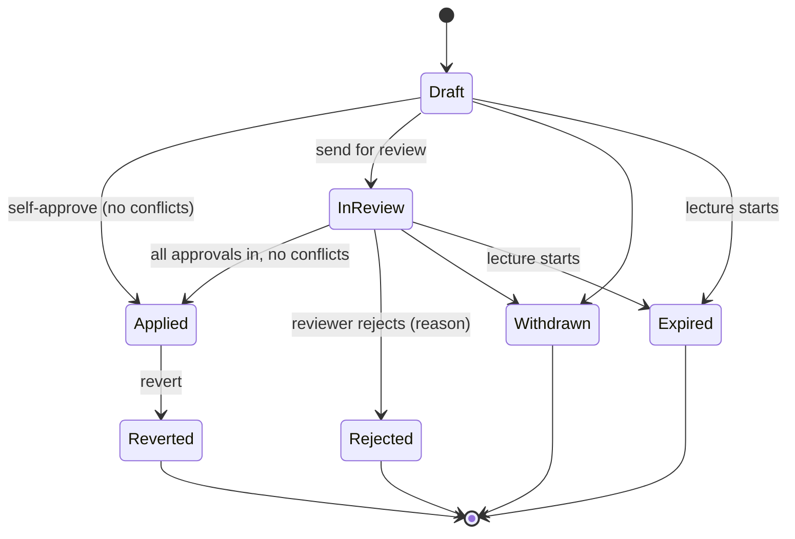

# Ticket lifecycle

- **Type:** rules
- **Module:** lecture-rescheduling
- **Status:** draft
- **Owner:** ishanKulkarni13
- **Last updated:** 2026-10-30

The states a [ticket](../../../shared/glossary/ticket.md) moves through. Original design: [module spec](../../lecture-rescheduling.md), section 9. Where this file differs from the spec, this file wins. Edits, withdrawal, revert, cancel, expiry, audit log and notifications per transition are still being decided and are added here as they are agreed.

## States

| State | Meaning |
| --- | --- |
| Draft | Being filled in, not visible to others. |
| In review | Sent for review. Waiting on one or more requested reviewers. |
| Applied | Written to the change overlay. Final for the ticket. |
| Rejected | A reviewer rejected it, with a mandatory reason. |
| Withdrawn | The author took it back before it was applied. |
| Expired | The lecture started before the ticket was applied. |
| Reverted | An applied change was undone. |

The spec's **Open** and **Approved** states are dropped. With [self-approval](../../../shared/glossary/self-approval.md), a ticket goes from Draft to Applied in one step, and "approved" is only the instant before it applies. Nobody could ever see those two states.

## Diagram

"Withdrawn" and the edit-after-rejection path are provisional until the next batch is decided.

## Conflicts and the lifecycle

- A ticket **with a conflict can still be sent for review**, like a pull request with merge conflicts. Review can go ahead, but the ticket **cannot be applied** while any [conflict](../../../shared/glossary/conflict.md) remains ([conflict rules](conflict-rules.md)).
- Conflicts are checked when the ticket is raised and again at the moment of applying.
- If a conflict appears while the ticket is In review (another ticket was applied first, see [same-slot tickets](same-slot-tickets.md), or a new ERP timetable version arrived, see [timetable version changes](../integration/timetable-version-changes.md)), the ticket **stays In review with a "conflicted" flag**. The author and the HOD are notified. Applying stays blocked until the conflict is fixed.

## Applied is final

**Applied is the end of a ticket's own life.** A [revert](reverts.md) or any later change is a **new ticket**, and the original is shown as Reverted with a link to the ticket that reverted it.
