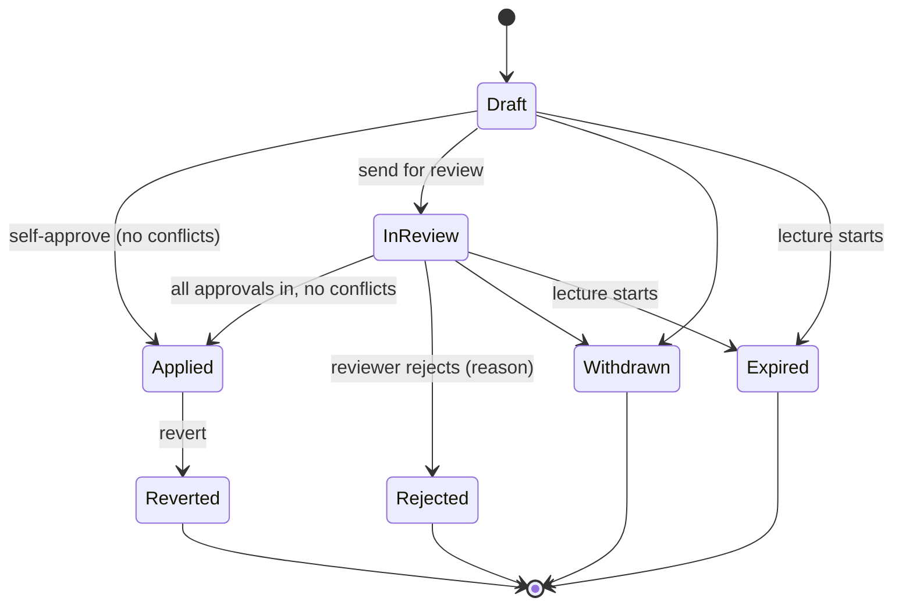

# Ticket lifecycle

- **Type:** rules
- **Module:** lecture-rescheduling
- **Status:** review
- **Owner:** ishanKulkarni13
- **Last updated:** 2026-11-06

The states a [ticket](../../../shared/glossary/ticket.md) moves through. Original design: [module spec](../../lecture-rescheduling.md), section 9. Where this file differs from the spec, this file wins. The audit log and notifications per transition are at the end of this file.

## States

| State | Meaning |
| --- | --- |
| Draft | Being filled in, not visible to others. |
| In review | Sent for review. Waiting on one or more requested reviewers. |
| Applied | Written to the change overlay. Final for the ticket. |
| Rejected | A reviewer rejected it, with a mandatory reason. Final. |
| Withdrawn | The author took it back before it was applied. |
| Expired | The lecture started before the ticket was applied. |
| Reverted | An applied change was undone. |

The spec's **Open** and **Approved** states are dropped. With [self-approval](../../../shared/glossary/self-approval.md), a ticket goes from Draft to Applied in one step, and "approved" is only the instant before it applies. Nobody could ever see those two states.

## Diagram

Rejected is final. Expiry applies to Draft and In review tickets (see below).

## Conflicts and the lifecycle

- A ticket **with a conflict can still be sent for review**, like a pull request with merge conflicts. Review can go ahead, but the ticket **cannot be applied** while any [conflict](../../../shared/glossary/conflict.md) remains ([conflict rules](conflict-rules.md)).
- Conflicts are checked when the ticket is raised and again at the moment of applying.
- If a conflict appears while the ticket is In review (another ticket was applied first, see [same-slot tickets](same-slot-tickets.md), or a new base timetable version was loaded, see [timetable version changes](../integration/timetable-version-changes.md)), the ticket **stays In review with a "conflicted" flag**. The author and the HOD are notified. Applying stays blocked until the conflict is fixed.

## Applied is final

**Applied is the end of a ticket's own life.** A [revert](reverts.md) or any later change is a **new ticket**, and the original is shown as Reverted with a link to the ticket that reverted it.

## Editing a ticket in review

- The author can edit a ticket while it is In review.
- Changing the **date, slot, room, lecture or change type clears all approvals**, and the requested reviewers are notified again.
- Changing only the **description or the reviewer list keeps approvals**. A newly added reviewer is notified.
- Every edit is written to the audit log.

## Rejected tickets

**Rejected is final.** The author raises a new ticket, which copies the details of the rejected one. The rejected ticket stays visible, and a rejection can still be escalated to the HOD ([approval model](approval-model.md)).

## Withdrawal

- The author can withdraw a ticket at any time before it is Applied, from Draft or In review.
- Requested reviewers are notified.
- A withdrawal after a reviewer has already approved needs no extra step. The audit log records it as **"withdrawn after approval"** so the history is not lost.

## Cancel and revert as lifecycle events

A cancel is an ordinary ticket, applied directly ([cancellation](cancellation.md)). Both of these ways to bring a cancelled lecture back are allowed:

1. **Revert the cancel.** The teaching faculty, or the HOD acting for them, raises a new revert ticket before the lecture starts. It is conflict-checked like any other change ([reverts](reverts.md)): if the slot or room has been taken since, it is blocked until fixed. If it passes, the **same occurrence is restored** with its history, and the original cancel ticket shows as Reverted, linked to the revert ticket.
2. **Raise an extra lecture.** This is a new, separate lecture, checked like any extra lecture. It does not restore the original occurrence.

## Expiry

Draft and In review tickets **expire when the earliest occurrence they involve starts**, whether that is the source or the target.

| Ticket | Expires when |
| --- | --- |
| Move a Friday lecture to Wednesday | Wednesday's slot starts. |
| Move a Wednesday lecture to Friday | Wednesday's lecture starts. |
| Extra lecture | The extra lecture's own slot starts. |
| Exchange | The first of the two occurrences starts. |

Expired tickets stay visible in history. A ticket that is Applied, Rejected, Withdrawn or Reverted never expires.

## Audit log

- **Records:** every state change, edit (with before and after values), review action and conflict flag, with who, when and from which state.
- **Who can read a ticket's log:** the author, requested reviewers, the HOD, the CR/BR within scope, and the Super Admin. Students see the result of a change, not the log.
- **Append-only:** entries are never edited or deleted. How long they are kept is an operations decision.
- Whether students can see tickets themselves (not just results) is open ([open questions](../open-questions.md)).

## Notifications per transition

In-app only, as in [notification triggers](../notifications/triggers.md).

| Transition | Who is notified |
| --- | --- |
| Sent for review | Requested reviewers and mentioned faculty. |
| Approved by a reviewer, or rejected | Author. A rejection includes the reason. |
| Applied | Author, affected students, the other faculty involved, the HOD, and the CR/BR within scope. A self-approval sends only this message. |
| Conflicted flag raised | Author and HOD. |
| Edited (approvals cleared) | Requested reviewers. |
| Withdrawn | Requested reviewers. |
| Expired | **Nobody.** |
| Reverted | Everyone who was notified of the original change. |
| Cancel applied | Students, the HOD, the CR/BR within scope, and the `occurrence.cancelled` event. |
